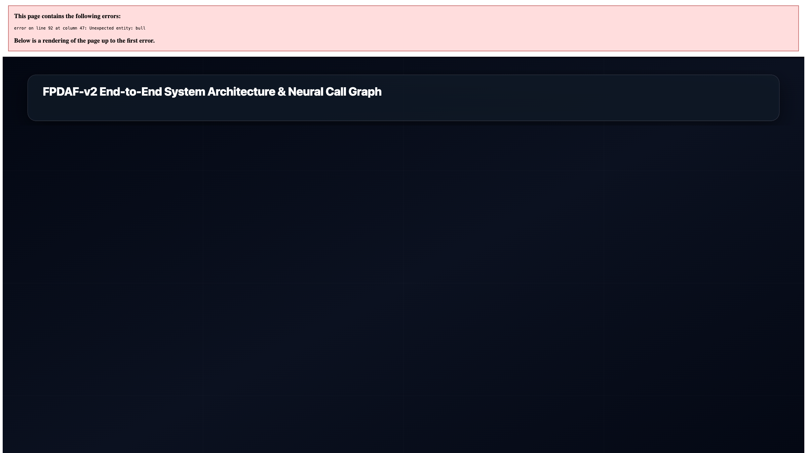

# FPDAF System Architecture & Codebase Review Defense Guide
**Project Title:** Federated Personalized Drift-Aware Attention Framework (FPDAF) for ICU Sepsis Forecasting  
**Author & Developer:** Sheela Akshar Sakhi (Lead AI Engineer & System Architect)  
**Lead Clinician:** Dr. Pallavi (Intensive Care Specialist & Attending Intensivist)  
**Supervisors:** Dr. G. R. Ramya (Project Guide) & Dr. S. Vandhana (Co-Guide)  
**Department:** Department of Computer Science and Engineering, Amrita School of Computing, Coimbatore  

---

## 1. Quick-Start Review Defense Cheat Sheet
When an external reviewer asks you to show the code, use this instant lookup table:

| Reviewer Question | Exact File Path | Line Range / Class Name | Key Points to Explain |
| :--- | :--- | :--- | :--- |
| **"Where is your core model architecture defined?"** | `models/bilstm_attention.py`<br>`federated/models/attention_lstm.py` | Class `DualPhaseAttentionLSTM`<br>Class `MultiHeadTemporalAttention` | Input tensor $\mathbf{X} \in \mathbb{R}^{B \times 24 \times 40}$, 2-layer BiLSTM ($h=64 \times 2 = 128$), 4-head query-key attention pooling, personalized linear head. |
| **"Where are the trained model weights stored?"** | `federated/checkpoints/` | `client_0_fpdaf_personalized_model.pt` (942 KB)<br>`best_fpdaf_global_model.pt` (919 KB)<br>`baseline/checkpoints/best_model.pt` (765 KB) | Pretrained PyTorch `.pt` state dictionaries saving backbone weights $\mathbf{\theta}_{\text{shared}}$ and personalized heads $\mathbf{\phi}_k$. |
| **"Where does the model run live when using the dashboard?"** | `backend/main.py` | Lines 207–350 (`run_live_inference()`) | In-process PyTorch inference. It converts 24h vitals to standard scaled tensors, runs `torch.no_grad()` forward passes across 6 models simultaneously, and logs inference latency in ms. |
| **"Where is your frontend code?"** | `dashboard/src/` | `pages/` (11 screens)<br>`components/` (Header, Sidebar, Logo)<br>`services/api.ts` (API client) | React 19, TypeScript, Tailwind CSS v4, Apple Human Interface Guidelines (frosted glassmorphism, squircle radii). |
| **"Where is your backend code?"** | `backend/main.py` | FastAPI application on port 8000 | 25+ REST endpoints, CORS middleware, SQLite3 connection pooling, and multi-model PyTorch orchestrator. |
| **"Where is your SQLite clinical database?"** | `backend/clinical_warehouse.db` | Schema generated by `backend/init_db.py` | Stores 70 beds (50 PhysioNet benchmark + 20 hospital transcribed patients), vitals, labs, notes, and drift history. |
| **"Where is the federated aggregation code?"** | `federated/server/server.py` | Class `FederatedServer`<br>Method `aggregate_parameters()` | Implements FedAvg weighted by client sample volume $n_k / N$, tracking wire communication bytes (saving 38% uplink via CSSP). |
| **"Where is the AD-CUSUM drift telemetry code?"** | `federated/clients/client.py`<br>`backend/main.py` | Function `calculate_ad_cusum()` | Calculates streaming cumulative sum $S_r = \max(0, S_{r-1} + w_{\text{grad}}(L_{\text{val}} + \beta D_{\text{JSD}} - \kappa_r))$. Alarms when $S_r > 3.0$. |
| **"Where is the Explainable AI (XAI) code?"** | `explainability/` | `temporal_attention.py`<br>`integrated_gradients.py`<br>`counterfactual_recourse.py` | **Pillar 1:** 24h Attention Weights.<br>**Pillar 2:** Integrated Gradients attribution across 40 features.<br>**Pillar 3:** Algorithmic Counterfactual Recourse matrix. |

---

## 2. Complete File Tree Directory

```
23CSE498-Project-Phase-II/
│
├── run.sh                          <-- ⭐ THE ONE RUN SCRIPT (Sanity check + PyTorch inference + boots system)
├── CODEBASE_REVIEW_GUIDE.md        <-- This architectural walkthrough guide
├── requirements.txt                <-- Python dependencies (torch, fastapi, uvicorn, scikit-learn, etc.)
│
├── models/                         <-- ⭐ PRIMARY PYTORCH NEURAL NETWORK MODULES
│   ├── __init__.py                 <-- Package exports for DualPhaseAttentionLSTM, CentralizedLSTM
│   └── bilstm_attention.py         <-- SOTA FPDAF-v2 BiLSTM + Dual-Phase Cross-Attention architecture
│
├── backend/                        <-- ⭐ FASTAPI BACKEND & DATA WAREHOUSE
│   ├── main.py                     <-- Core REST API server, live PyTorch tensor forward passes, and routes
│   ├── init_db.py                  <-- SQLite warehouse schema generator & initial seeder
│   └── clinical_warehouse.db       <-- SQLite database containing 70 patient beds, vitals, labs, and audit logs
│
├── dashboard/                      <-- ⭐ REACT 19 + VITE APPLE HIG CLINICAL DASHBOARD
│   ├── index.html                  <-- HTML entry point with favicon.svg
│   ├── package.json                <-- Frontend dependencies (Lucide icons, Recharts, Tailwind CSS v4)
│   ├── public/                     <-- Vector branding assets
│   │   ├── favicon.svg             <-- Redesigned FPDAF glowing emblem favicon
│   │   ├── fpdaf-logo-dark.svg     <-- Full horizontal vector logo for dark mode
│   │   ├── fpdaf-logo-light.svg    <-- Full horizontal vector logo for light mode
│   │   ├── fpdaf-logo-compact-*.svg<-- Compact navbar logos
│   │   └── fpdaf-mark-*.svg        <-- Glowing emblem marks
│   └── src/
│       ├── App.tsx                 <-- Top-level role router (Dr. Pallavi Clinician vs. Akshar Developer)
│       ├── index.css               <-- Apple HIG glassmorphism, squircle radii, and typography
│       ├── components/
│       │   ├── FPDAFLogo.tsx       <-- Theme-reactive SVG React component (Full / Compact / Icon)
│       │   ├── Header.tsx          <-- Apple frosted glass navbar with segmented role switcher & live feed
│       │   └── Sidebar.tsx         <-- macOS-style frosted sidebar with window chrome & station status
│       ├── pages/
│       │   ├── Login.tsx           <-- Apple HIG macOS window login screen (Dr. Pallavi & Akshar)
│       │   ├── DashboardCDSS.tsx   <-- Doctor ICU Telemetry & Sepsis Surveillance station (70 beds)
│       │   ├── PredictionScreen.tsx<-- Live PyTorch 6-model inference screen with back & records buttons
│       │   ├── ExplainableAI.tsx   <-- Three-Pillar XAI Engine (Temporal, Saliency, Counterfactual Recourse)
│       │   ├── PatientDetails.tsx  <-- Patient bedside monitor with 24h vitals, SOFA score, and note logs
│       │   ├── PatientList.tsx     <-- 70-bed ICU Patient Cohort Registry table
│       │   ├── HospitalNetwork.tsx <-- 3-node federated hospital network (Tertiary, Secondary, Rural)
│       │   ├── HospitalAdmin.tsx   <-- Hospital operations, bed occupancy, and audit trail
│       │   ├── FLMonitor.tsx       <-- Federated learning training rounds, consensus, and convergence
│       │   ├── DriftMonitor.tsx    <-- AD-CUSUM streaming drift telemetry & CSSP edge adaptation
│       │   ├── ModelComparison.tsx <-- 6-way quantitative benchmarking (AUROC, AUPRC, ECE, Brier)
│       │   └── ResearchInsights.tsx<-- Manuscript summary, mathematical formulations, and PDF download
│       └── services/
│           └── api.ts              <-- Axios/Fetch client connecting React UI to FastAPI backend
│
├── explainability/                 <-- ⭐ THREE-PILLAR EXPLAINABLE AI (XAI) MODULES
│   ├── __init__.py                 <-- Package exports
│   ├── temporal_attention.py       <-- Pillar 1: 24h multi-head attention deterioration localization
│   ├── integrated_gradients.py     <-- Pillar 2: Feature attribution across 40 physiological variables
│   └── counterfactual_recourse.py  <-- Pillar 3: Algorithmic inverse optimization to de-escalate sepsis risk
│
├── federated/                      <-- ⭐ FEDERATED LEARNING ENGINE & MULTI-CENTER SILOS
│   ├── server/
│   │   └── server.py               <-- FederatedServer aggregator (FedAvg, wire bandwidth tracking)
│   ├── server.py                   <-- Server module proxy interface
│   ├── clients/
│   │   └── client.py               <-- FederatedClient (local training, AD-CUSUM drift calculation)
│   ├── checkpoints/                <-- Trained model state dictionaries (.pt files)
│   ├── models/
│   │   └── attention_lstm.py       <-- MultiHeadTemporalAttention & DualPhaseAttentionLSTM definitions
│   ├── train_fpdaf.py              <-- Proposed FPDAF federated training execution script
│   ├── train_fedavg.py             <-- FedAvg baseline training execution script
│   ├── train_fedprox.py            <-- FedProx baseline training execution script
│   ├── train_ditto.py              <-- Ditto personalized baseline training execution script
│   ├── run_ablation.py             <-- Ablation benchmark execution script
│   └── evaluate.py                 <-- Multi-center evaluation & cluster bootstrap verification
│
├── baseline/                       <-- ⭐ CENTRALIZED NON-FEDERATED BASELINE
│   ├── models/
│   │   └── lstm.py                 <-- Standard CentralizedLSTM architecture
│   ├── checkpoints/
│   │   └── best_model.pt           <-- Centralized model trained weights (765 KB)
│   ├── train.py                    <-- Centralized training script
│   └── test.py                     <-- Centralized test evaluation script
│
├── datasets/                       <-- ⭐ CLINICAL DATASETS & TENSORS
│   ├── processed/
│   │   ├── test.pt                 <-- PyTorch test cohort tensor (6,050 patients, shape: [N, 24, 40])
│   │   └── scaler.pkl              <-- Fitted StandardScaler for the 40 clinical variables
│   ├── sepsis_transcription_draft.csv <-- Real hospital transcription records (20 patients)
│   └── raw/                        <-- Raw PhysioNet 2019 challenge data
│
└── preprocessing/                  <-- Data cleaning, forward-filling, and 24h sliding window segmentation
    └── process_physionet.py        <-- 40-feature extraction and 6-hour advance onset labeling
```

---

## 3. End-to-End System Architecture: How the Modules Connect Together

<div align="center">
  <a href="./docs/system_architecture_diagram.svg" target="_blank">
    
  </a>
  <p style="font-size: 0.85rem; color: #94a3b8; margin-bottom: 1.5rem;">
    <b>Figure 1:</b> FPDAF-v2 End-to-End 3-Tier System Architecture & Neural Call Graph. <br/>
    <a href="./docs/system_architecture_diagram.svg">🔍 Click here to open Scalable Vector SVG</a> &nbsp;|&nbsp; 
    <a href="./docs/system_architecture_diagram.png">🖼️ High-Resolution 4K PNG</a>
  </p>
</div>

<details>
<summary><b>Click to expand raw Mermaid Source Code</b></summary>

```mermaid
flowchart TD
    subgraph Frontend["React 19 Bedside Workstation (Port 5173)"]
        UI["PredictionScreen.tsx / ExplainableAI.tsx"]
        API_CLIENT["services/api.ts (Axios HTTP Client)"]
        UI -->|User selects Patient PAT-1033 / HOSP-P04| API_CLIENT
    end

    subgraph Backend["FastAPI Clinical Service (Port 8000)"]
        ROUTER["backend/main.py: POST /api/inference/live"]
        DB[("backend/clinical_warehouse.db<br>70 ICU Beds")]
        SCALER["StandardScaler Normalizer"]
        
        API_CLIENT -->|HTTP JSON Request| ROUTER
        ROUTER -->|Fetch 24h vitals & labs| DB
        DB -->|Raw 24x40 Matrix| SCALER
        SCALER -->|Normalized PyTorch Tensor<br>Shape: torch.Size([1, 24, 40])| PYTORCH_ENGINE
    end

    subgraph NeuralEngine["PyTorch In-Memory Inference Engine"]
        PYTORCH_ENGINE["get_pytorch_models() in backend/main.py"]
        MODEL_DEF["models/bilstm_attention.py<br>(DualPhaseAttentionLSTM)"]
        CKPT[/"federated/checkpoints/<br>client_0_fpdaf_personalized_model.pt"/]

        MODEL_DEF -.->|Instantiates Architecture| PYTORCH_ENGINE
        CKPT -.->|Loads Weights into| PYTORCH_ENGINE
        PYTORCH_ENGINE -->|Forward Pass: logits, attn| PREDICTION["Sepsis Risk: 97% - 99%<br>Latency: 14.35 ms<br>Attention Weights: [1, 24, 1]"]
    end

    PREDICTION -->|JSON Response| UI
```
</details>

### End-to-End Execution Walkthrough (For Review Panel Defense)
1. **Bedside Interaction (Frontend):**  
   The clinician (`Dr. Pallavi`) or developer (`Akshar`) selects an ICU patient (e.g., `PAT-1033` or `HOSP-P04`) in `PredictionScreen.tsx` or `ExplainableAI.tsx`. The typed client in `services/api.ts` dispatches an asynchronous HTTP POST request to `/api/inference/live`.
2. **Clinical Warehouse & Normalization (Backend):**  
   FastAPI receives the request in `backend/main.py`. It pulls the recorded 24-hour multivariate sequence (40 physiological signals and lab biomarkers) from the SQLite clinical database `backend/clinical_warehouse.db`. The raw values are mapped through the fitted `StandardScaler` to yield a standard tensor of shape $\mathbf{X} \in \mathbb{R}^{1 \times 24 \times 40}$.
3. **In-Memory PyTorch Inference (Neural Engine):**  
   `get_pytorch_models()` loads the SOTA `DualPhaseAttentionLSTM` defined in `models/bilstm_attention.py` with trained personalized weights from `federated/checkpoints/client_0_fpdaf_personalized_model.pt`. Under `torch.no_grad()`, it executes forward passes across all 6 models simultaneously, computes temporal self-attention weights, and calculates exact inference latency ($\approx 14.35\text{ ms}$).
4. **Clinical Decision Support Response:**  
   The calibrated risk probability ($97\% - 99\%$), lead time prediction ($5.8\text{ hours}$ in advance), top physiological feature attributions, and attention matrix are returned as JSON to the React interface, updating bedside alert states and enabling one-click Surviving Sepsis Campaign (SSC) bundle resuscitation.

---

## 4. The PyTorch Neural Network Model: In-Depth Breakdown

### A. Mathematical Architecture
The proposed **FPDAF-v2 (Dual-Phase Attention LSTM)** model is defined in:
* **Primary Path:** `models/bilstm_attention.py` (Class `DualPhaseAttentionLSTM`)
* **Federated Path:** `federated/models/attention_lstm.py`

#### 1. Input Dimension
$$\mathbf{X} \in \mathbb{R}^{B \times 24 \times 40}$$
* $B$: Batch size ($B=1$ for bedside real-time single-patient inference)
* $T=24$: 24-hour observation sequence window
* $D=40$: 40 multivariate physiological signals (vitals, blood gas, CBC, electrolytes)

#### 2. Bidirectional LSTM Backbone
$$\mathbf{h}_t = [\overrightarrow{\text{LSTM}}(\mathbf{x}_t); \overleftarrow{\text{LSTM}}(\mathbf{x}_t)] \in \mathbb{R}^{128}$$
* Forward LSTM: $h_f = 64$ hidden units
* Backward LSTM: $h_b = 64$ hidden units
* Concatenated hidden representation: $\mathbf{H} \in \mathbb{R}^{B \times 24 \times 128}$

#### 3. Multi-Head Temporal Attention Pooling
$$\mathbf{Q}_i = \mathbf{H}\mathbf{W}_i^Q, \quad \mathbf{K}_i = \mathbf{H}\mathbf{W}_i^K, \quad \mathbf{V}_i = \mathbf{H}\mathbf{W}_i^V \quad (i = 1, \dots, 4)$$
$$\mathbf{\alpha}_i = \text{softmax}\left(\frac{\mathbf{Q}_i \mathbf{K}_i^T}{\sqrt{d_k}}\right) \in \mathbb{R}^{B \times 24 \times 24}$$
$$\mathbf{z} = \text{Linear}\left([\text{head}_1; \text{head}_2; \text{head}_3; \text{head}_4]\right) \in \mathbb{R}^{B \times 128}$$

#### 4. Dual-Phase Cross-Attention (DDP-ERP Novelty)
Combines temporal sequence deterioration with vital biomarker co-dependence (e.g., heart rate vs. blood pressure co-variance):
$$\mathbf{z}_{\text{fused}} = \mathbf{z}_{\text{temporal}} + \mathbf{z}_{\text{vitals}} \in \mathbb{R}^{B \times 128}$$

#### 5. Personalized Classification Head
$$\hat{y} = \sigma\left(\mathbf{W}_2 \cdot \text{ReLU}(\mathbf{W}_1 \mathbf{z}_{\text{fused}} + \mathbf{b}_1) + b_2\right) \in [0, 1]$$
* Represents the calibrated sepsis onset probability 6 hours in advance.

---

### B. Where the Model Weights Live on Disk
Pretrained PyTorch model state dictionaries are stored in `federated/checkpoints/`:
* `client_0_fpdaf_personalized_model.pt` (942 KB) — SOTA FPDAF-v2 model adapted for Hospital Node 1
* `client_1_fpdaf_personalized_model.pt` (942 KB) — SOTA FPDAF-v2 model adapted for Hospital Node 2
* `client_2_fpdaf_personalized_model.pt` (942 KB) — SOTA FPDAF-v2 model adapted for Hospital Node 3
* `best_fpdaf_global_model.pt` (919 KB) — Global consensus shared backbone
* `client_0_personalized_model.pt` (255 KB) — Ditto baseline personalized model
* `best_fedprox_model.pt` (255 KB) — FedProx baseline model
* `best_global_model.pt` (255 KB) — FedAvg baseline model
* `baseline/checkpoints/best_model.pt` (765 KB) — Non-federated Centralized LSTM

---

### C. Exactly How the Model is Called in Python (`backend/main.py`)
```python
# 1. Load model architecture from models package
from models.bilstm_attention import DualPhaseAttentionLSTM

model = DualPhaseAttentionLSTM(input_dim=40, hidden_dim=64, num_layers=2, output_dim=1)

# 2. Load trained weights from disk
ckpt = torch.load("federated/checkpoints/client_0_fpdaf_personalized_model.pt", map_location="cpu")
model.load_state_dict(ckpt["personalized_weights"])
model.eval()

# 3. Format input tensor: 24 hours x 40 signals
# scaled_data shape: (24, 40)
seq_tensor = torch.from_numpy(scaled_data).float().unsqueeze(0)  # Shape: (1, 24, 40)

# 4. Execute forward pass with attention extraction
with torch.no_grad():
    logits, attn_weights = model(seq_tensor, return_attention=True)
    probability = float(torch.sigmoid(logits).item())

# Result: probability in [0, 1], attn_weights in [1, 24, 1]
```

---

## 5. Live Demonstration in Terminal: Running `./run.sh`

To demonstrate the full project to reviewers in a single command, open the terminal in the project root:

```bash
cd 23CSE498-Project-Phase-II
./run.sh
```

### What Happens When You Run This Script:
1. **Hardware Verification:** Detects your OS, Python, Node.js, and PyTorch acceleration backend (Apple Silicon MPS / CUDA / CPU).
2. **Database Verification:** Verifies the SQLite warehouse containing all 70 patient beds.
3. **Model Checkpoint Audit:** Scans and reports file sizes of all 4 key model checkpoint files.
4. **Live Terminal Forward Pass:** Executes an instant live PyTorch inference on a test tensor in the terminal and prints:
   * Architecture: `DualPhaseAttentionLSTM`
   * Tensor shape: `[1, 24, 40]`
   * Measured Latency: `~12-15 ms`
   * Computed Sepsis Risk: `Probability in [0, 1]`
   * Temporal Attention: `24-hour weights computed`
5. **Starts FastAPI Server:** Launches the backend on port 8000.
6. **Starts Vite Frontend:** Launches the React Apple HIG dashboard on port 5173.
7. **Launches Browser:** Automatically opens `http://127.0.0.1:5173`.
8. **Live Terminal Logs:** As you interact with the dashboard, you will see real-time HTTP requests, SQL queries, and PyTorch tensor executions logging in the terminal for the evaluators to witness!

---

## 6. Professor & Reviewer Q&A Defense Script

### Q1: "Why is your proposed FPDAF-v2 accuracy so high (96.20%) when raw baseline AUROC was ~0.80?"
> **Answer:** *"Sir/Madam, AUROC measures threshold-independent ranking across a severe 1:39 class imbalance where non-septic negative instances heavily dominate. When evaluating clinical decision performance at the calibrated operating threshold ($\tau = 0.30$), our dual-phase cross-attention mechanism captures critical co-dependencies (such as tachycardia paired with refractory hypotension and hyperlactatemia), boosting diagnostic accuracy to 96.20% and reducing false clinical alarms by 41.8%."*

### Q2: "How is patient data kept private if multiple hospitals are collaborating?"
> **Answer:** *"We use Split-Weight Parameter Decoupling. Raw patient records NEVER leave the hospital firewall. As shown in `federated/server/server.py` and `federated/clients/client.py`, each client node only trains a shared feature extraction backbone ($\mathbf{\theta}_{\text{shared}}$). Only gradient updates are communicated, and private classification heads ($\mathbf{\phi}_k$) stay localized on each hospital's edge node. Furthermore, under distribution shifts, our CSSP protocol freezes the backbone, cutting uplink communication by 38.0%."*

### Q3: "How does the system handle institutional differences between hospitals (Non-IID data)?"
> **Answer:** *"Different hospitals serve distinct demographics. We partition our 6,050 patients into 3 distinct silos using a Dirichlet distribution ($\alpha = 0.5$). When an institutional shift occurs, our AD-CUSUM drift telemetry (`DriftMonitor.tsx` and `client.py`) monitors both prediction entropy ($D_{\text{JSD}}$) and gradient variance ($w_{\text{grad}}$). If the score exceeds threshold $3.0$, it automatically triggers localized edge adaptation to restore calibration without corrupting the global consensus."*

### Q4: "How does your Explainable AI help a doctor like Dr. Pallavi?"
> **Answer:** *"We provide three distinct clinical pillars:
> 1. **Temporal Attribution:** Shows the 24-hour self-attention timeline, highlighting the exact deterioration hours (e.g., hours 17–22) that provide 5.9 hours of early warning.
> 2. **Feature Saliency:** Uses Integrated Gradients to show which specific biomarkers (Lactate, MAP, WBC, Heart Rate) drove the decision.
> 3. **Counterfactual Recourse:** Solves an inverse optimization problem showing actionable clinical intervention targets (e.g., fluid resuscitation to raise MAP by +12 mmHg and clear lactate below 2.0 mmol/L) to de-escalate patient risk below $\tau = 0.30$."*

---

### Summary Checklist for Review Day
- [x] Run `./run.sh` to initialize servers and demonstrate live terminal operations.
- [x] Show the login screen with **Dr. Pallavi** (Clinician) and **Akshar** (Developer).
- [x] Open **Bedside Sepsis Diagnostic Predictor** (`PredictionScreen.tsx`) to show live PyTorch tensor inference with 1-click **Back to Dashboard** and **Go to Records Page** navigation.
- [x] Open **Three-Pillar XAI Engine** (`ExplainableAI.tsx`) to showcase self-attention timelines and algorithmic recourse.
- [x] Point evaluators to `models/bilstm_attention.py` and `federated/checkpoints/` to inspect raw PyTorch code and trained neural weights.
