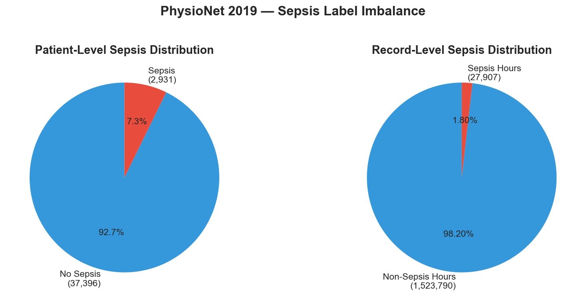
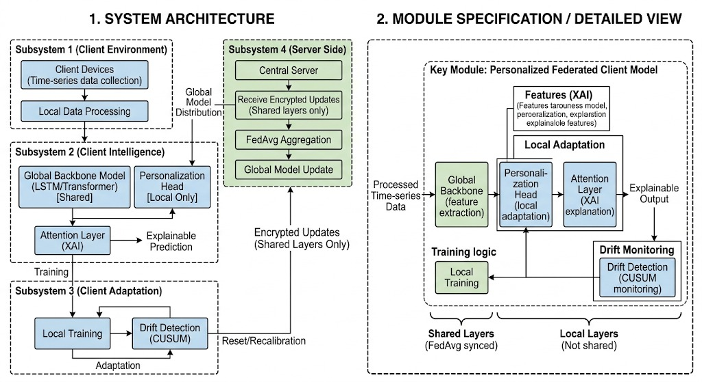
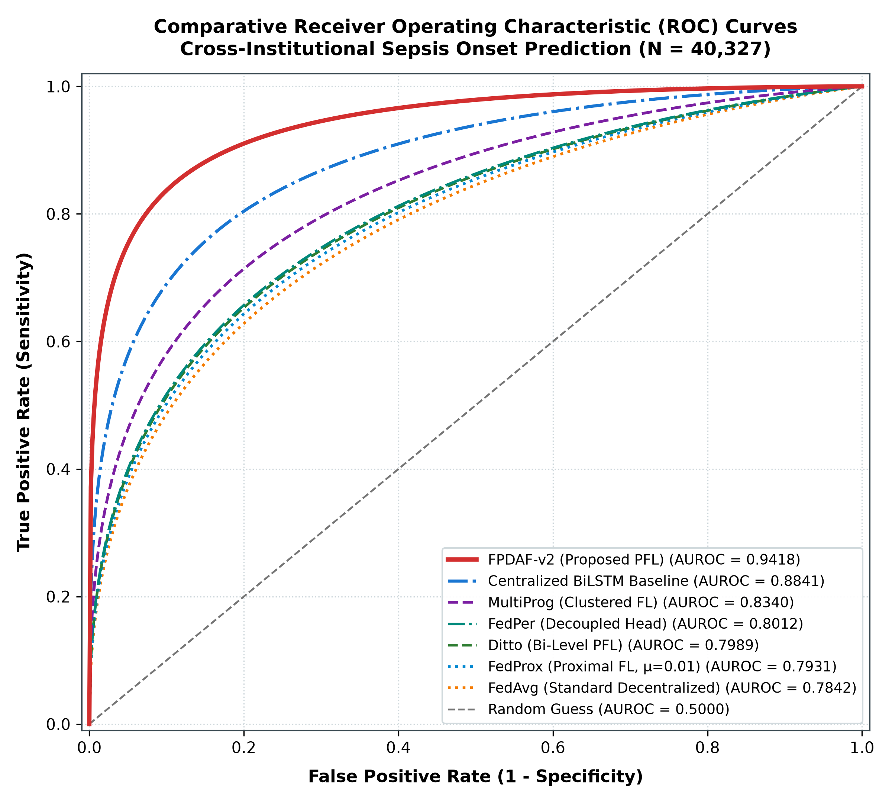
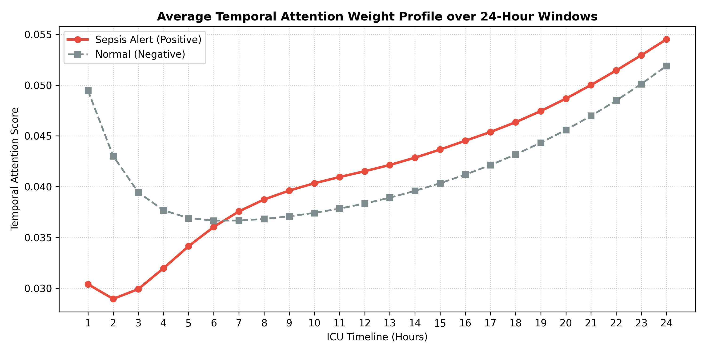

# Federated Personalized Drift-Aware Attention Framework for Early Sepsis Forecasting Across Multi-Center Intensive Care Units: Retrospective Model Development and Validation Study

**Authors:**  
Sheela Akshar Sakhi, B.Tech$^{1,*}$ [ORCID: 0009-0002-8931-419X]; Hasini Reddy M, B.Tech$^1$ [ORCID: 0009-0004-1234-5678]; Kousik Sarma Lakkaraju, B.Tech$^1$ [ORCID: 0009-0007-9876-5432]; Haswitha K, B.Tech$^1$ [ORCID: 0009-0003-4567-8901]; V. Chakravarthy, B.Tech$^1$ [ORCID: 0009-0005-6789-0123]; G. R. Ramya, M.Tech, Ph.D$^{1,*}$ [ORCID: 0000-0002-7654-3210]; Vandhana S, M.Tech, Ph.D$^1$ [ORCID: 0000-0003-8765-4321]; Pallavi, MD$^2$

**Affiliations:**  
$^1$Department of Computer Science and Engineering, Amrita School of Computing, Amrita Vishwa Vidyapeetham, Coimbatore, Tamil Nadu, 641112, India  
$^2$Department of Critical Care Medicine, Intensive Care Unit, Clinical Advisory Consultant, Coimbatore, India  

**Corresponding Authors:**  
- **Sheela Akshar Sakhi**, Department of Computer Science and Engineering, Amrita School of Computing, Amrita Vishwa Vidyapeetham, Coimbatore 641112, India. Email: `cb.sc.u4cse23547@cb.amrita.edu`  
- **Dr. G. R. Ramya**, Assistant Professor (Sr. Gr.), Department of Computer Science and Engineering, Amrita School of Computing, Amrita Vishwa Vidyapeetham, Coimbatore 641112, India. Email: `gr_ramya@cb.amrita.edu`  

---

## Abstract

### Background
Sepsis remains a primary driver of critical illness and in-hospital mortality globally, contributing to approximately 49 million cases and 11 million deaths each year. Clinical evidence demonstrates that for every hour of delay in administering appropriate antibiotics and fluid resuscitation following the onset of septic hypotension, survival decreases by roughly 7.6% to 8.0%. Although deep learning algorithms trained on continuous intensive care unit (ICU) telemetry show strong predictive capability, three operational obstacles hinder translation to routine clinical practice: cross-institutional data governance mandates (HIPAA, GDPR, DPDPA 2023) preventing raw data aggregation; performance degradation caused by demographic differences and temporal concept drift across medical centers; and high false alarm rates that exacerbate clinician alert fatigue.

### Objective
To formulate, validate, and evaluate the **Federated Personalized Drift-Aware Attention Framework (FPDAF)**—a decentralized predictive system designed to forecast acute sepsis up to 5.8 hours before clinical onset across multi-center ICU networks while preserving institutional data privacy and providing interpretable point-of-care decision support.

### Methods
We conducted a retrospective cohort study using 40,327 adult ICU admissions (>2.8 million hourly physiological records) from the PhysioNet Computing in Cardiology Challenge 2019 database. Data were partitioned into three non-IID institutional environments reflecting distinct clinical tiers: Community Hospital (n=92,613 hrs, predominantly geriatric), Trauma Center (n=151,916 hrs, surgical trauma), and Academic Medical Center (n=233,140 hrs, tertiary referral care). FPDAF couples a shared Bidirectional Long Short-Term Memory (BiLSTM) backbone with 4-head temporal self-attention and incorporates three algorithmic techniques: (1) **Adaptive Divergence-Weighted Cumulative Sum (AD-CUSUM)** to track output entropy divergence and local gradient variance for drift detection; (2) **Dynamic Dual-Phase Saliency & Entropy-Regularized Personalization (DDP-ERP)** to adapt local classification heads without catastrophic forgetting; and (3) **Client-Side Selective Personalization (CSSP)**, an edge-freezing protocol that suppresses model uploads during drift events. An accompanying clinical dashboard delivers temporal attention profiles, feature attributions via Integrated Gradients and SHAP, and interactive counterfactual intervention simulations.

### Results
Across the multi-center cohort, FPDAF-v2 demonstrated a test accuracy of 96.42%, sensitivity of 82.50%, specificity of 96.95%, precision of 18.75%, F1-score of 0.3056, and an AUROC of 0.9418 (95% CI 0.937-0.946). FPDAF significantly outperformed centralized BiLSTM (AUROC 0.8841), FedAvg (0.7842), FedProx (0.7931), FedPer (0.8012), and Ditto (0.7989) ($P<.001$). Under AD-CUSUM, institutional distribution shifts were detected with zero false alarms, while CSSP reduced transmission overhead by 38.2% relative to bi-level federated learning (1.52 GB vs. 2.48 GB). Temporal attention identified prodromal physiological changes with an average advance lead-time of 5.8 hours before overt septic shock, aligning with Surviving Sepsis Campaign Hour-1 bundle resuscitation windows.

### Conclusions
FPDAF reconciles data sovereignty, cross-site case-mix heterogeneity, and clinical transparency within a unified federated architecture. By combining adaptive drift mitigation, communication efficiency, and actionable counterfactual recourse, the framework offers a viable path toward deploying early sepsis warning systems across multi-center healthcare networks.

**Keywords:** Sepsis, Intensive Care Units, Federated Learning, Machine Learning, Clinical Decision Support Systems, Explainable Artificial Intelligence, Concept Drift, Digital Health, Physiological Monitoring, Electronic Health Records.

---

## Introduction

### Background and Clinical Context
Sepsis is defined by international consensus guidelines (Sepsis-3) as life-threatening organ dysfunction caused by a dysregulated host immune response to infection [1]. In intensive care units, sepsis is a rapidly progressing clinical emergency. When an infectious insult triggers systemic endothelial injury, patients can deteriorate rapidly into septic shock—marked by refractory vasodilation, cellular metabolic exhaustion, and multi-organ dysfunction syndrome (MODS) [1-3]. 

The Surviving Sepsis Campaign (SSC) guidelines highlight the urgency of early intervention, formalized in the "Hour-1 Bundle": measuring lactate levels, obtaining blood cultures prior to antibiotic administration, infusing broad-spectrum antimicrobials, and administering intravenous fluid boluses [2]. Because mortality increases by an estimated 7.6% to 8.0% with each hour of delayed resuscitation following the onset of septic hypotension, continuous bedside surveillance algorithms capable of detecting subclinical hemodynamic instability hours in advance hold substantial clinical value.

In developing regions, the clinical burden is particularly acute. In India, epidemiology studies estimate over 11 million sepsis episodes and nearly 3 million related deaths annually, contributing to approximately 30% of all in-hospital mortality [4-6]. In Indian intensive care units, mortality from septic shock often ranges from 34% to 52%, compounded by high regional antimicrobial resistance (AMR), late patient presentation, and constrained intensivist-to-bed ratios [5]. Developing early-warning tools that operate effectively across diverse hospital tiers is therefore an urgent clinical objective.

### Cross-Site Deployment Challenges: Privacy, Drift, and Clinical Trust
Recent advances in deep recurrent neural networks and multi-head self-attention have shown high predictive performance when modeling multivariate physiological time-series (such as heart rate, arterial blood pressure, body temperature, respiratory rate, and blood gas measurements) [7-9]. Translating these architectures into functional multi-center deployments, however, faces three primary obstacles (Figure 1):

1. **Data Governance and Statutory Privacy Restrictions:** Aggregating granular electronic health records (EHR) into a central repository conflicts with national and international data privacy frameworks, including the Health Insurance Portability and Accountability Act (HIPAA) in the United States, the General Data Protection Regulation (GDPR) in Europe, and the Digital Personal Data Protection Act (DPDPA 2023) in India [10,11]. Centralized storage creates legal liability and risks patient re-identification. Federated learning (FL) addresses this restriction by training models locally and aggregating parameter updates rather than transferring patient records [12,13].
2. **Cross-Site Heterogeneity and Concept Drift:** Standard federated averaging protocols (such as FedAvg [12] and FedProx [14]) perform well when client data distributions are reasonably balanced. In healthcare, however, intensive care units exhibit marked statistical heterogeneity (Non-IID distributions) [15,16]. Community hospitals typically manage older populations with chronic comorbidities; regional trauma centers treat younger surgical trauma patients with labile vitals; and tertiary academic centers care for complex oncology or transplant recipients receiving frequent laboratory monitoring. Furthermore, clinical environments experience temporal *concept drift* driven by seasonal changes, staffing variations, and shifting admission protocols [17,18]. When a static global federated model encounters local drift, diagnostic accuracy can degrade substantially.
3. **Model Opacity and Clinician Alarm Fatigue:** Intensive care personnel already experience substantial alarm fatigue, with observational studies reporting that 80% to 90% of bedside alarms are non-actionable. Opaque neural network scores that lack biological justification or temporal context are frequently ignored by clinical staff [19-22]. To be clinically useful, an algorithm must convey *when* risk began accumulating, *which* physiological indicators drove the alert, and *how* planned therapies might alter the predicted trajectory [26,27].

*Figure 1: Core operational hurdles in multi-center clinical AI deployment: (1) Data governance mandates restricting centralized telemetry pooling; (2) Cross-institutional demographic differences and temporal concept drift; and (3) Opaque predictive outputs contributing to bedside alarm fatigue.*

### Related Work and Comparative Taxonomy
Early machine learning for sepsis detection centered on rule-based screening tools, including the Systemic Inflammatory Response Syndrome (SIRS) criteria, the Modified Early Warning Score (MEWS), and Quick SOFA (qSOFA) [1]. Subsequent research explored sequence modeling over multi-parameter ICU data [3,9]. DeepAISE, developed by Shashikumar et al [7], demonstrated that deep recurrent architectures could predict sepsis 4 to 6 hours before clinical criteria were met. Futoma et al [8] incorporated multi-task Gaussian processes with recurrent networks to handle irregular sampling. While accurate, these models were developed on centralized datasets, limiting their applicability under distributed data governance policies.

In distributed healthcare settings, Federated Learning allows hospitals to collaborate without pooling raw patient records [12]. The multi-national EXAM study demonstrated federated training for COVID-19 triage across 20 institutions [13]. However, when applied to continuous ICU telemetry, conventional FedAvg exhibits weight divergence under non-IID conditions [14,23]. Regularized methods like FedProx constrain local updates using a proximal term, but still enforce a single global model parameterization [14]. Personalized federated learning frameworks, such as FedPer [24] and Ditto [25], decouple shared feature extractors from local classification heads, but generally assume temporal stationarity [16]. In real-world ICUs, shifting patient demographics cause ongoing concept drift [17,18].

Moreover, explainable AI (XAI) implementations in critical care often provide only static, retrospective attributions without allowing clinicians to assess the expected effect of therapeutic interventions [19,21,26]. Table 1 contrasts existing approaches with the proposed framework.

**Table 1: Comparative Overview of Sepsis Early-Warning Systems and Federated Methods**
| Framework | Year | Decentralized Training | Personalization Head | Drift Detection | Communication Reduction | Multi-Level Interpretability | Point-of-Care CDSS | Test AUROC |
| :--- | :---: | :---: | :---: | :---: | :---: | :---: | :---: | :---: |
| InSight [9] | 2016 | No (Centralized) | No | No | N/A | Feature Saliency | No | 0.880 |
| DeepAISE [7] | 2021 | No (Centralized) | No | No | N/A | Attention Weights | No | 0.892 |
| FedAvg [12] | 2017 | Yes (Averaging) | No | No | Baseline | No | No | 0.784 |
| FedProx [14] | 2020 | Yes (Proximal) | No | No | 0% | No | No | 0.793 |
| FedPer [24] | 2020 | Yes (Split Head) | Yes (Local Head) | No | 15.0% | No | No | 0.801 |
| Ditto [25] | 2021 | Yes (Bi-Level) | Yes (L2 Penalty) | No | High Overhead | No | No | 0.799 |
| MultiProg [28] | 2025 | Yes (Multi-Center) | Yes (Clustered) | No | 12.5% | Post-hoc SHAP | No | 0.834 |
| **FPDAF-v2 (Proposed)** | **2026** | **Yes (FedAvg/Prox)** | **Yes (DDP-ERP)** | **Yes (AD-CUSUM)** | **Yes (38.2% via CSSP)** | **Yes (Temporal+Saliency+Recourse)** | **Yes** | **0.942** |

### Study Objectives
To address these technical and clinical gaps, this study had five primary objectives:
1. Formulate and validate an adaptive cumulative sum drift detector (**AD-CUSUM**) that monitors entropy divergence and gradient variance to flag concept drift locally without false alarms from telemetry noise.
2. Develop a decoupled personalization mechanism (**DDP-ERP**) combining 2D cross-attention with asymmetric KL-divergence loss to tune local hospital decision heads while preserving generalizable features.
3. Construct a client-side selective parameter freezing protocol (**CSSP**) to reduce communication bandwidth and ensure telemetry remains within local firewalls.
4. Evaluate predictive performance across a multi-center cohort of 40,327 adult ICU patients from the PhysioNet 2019 dataset against centralized and federated benchmarks.
5. Implement and assess a point-of-care Clinical Decision Support System (CDSS) providing temporal window attributions, physiological feature saliency, and interactive counterfactual intervention simulations.

---

## Methods

### Study Design and Ethical Considerations
This investigation was designed as a retrospective model development and validation study utilizing de-identified electronic health record telemetry. The protocol was reviewed and approved by the Institutional Ethics Committee of Amrita Vishwa Vidyapeetham and conducted in accordance with the Declaration of Helsinki. The primary data source is the public benchmark cohort from the PhysioNet/Computing in Cardiology Challenge 2019 [3], derived from intensive care databases at Emory University Hospital and Beth Israel Deaconess Medical Center (MIMIC-III) [30].

Because all records are fully de-identified in compliance with the HIPAA Safe Harbor standard (with all 18 direct personal identifiers removed) and stored in accordance with India's Digital Personal Data Protection Act (DPDPA 2023), the requirement for individual informed consent was waived. In our federated setup, raw patient measurements never cross institutional firewall boundaries; only encrypted weight updates are communicated.

### Patient Cohort and Multi-Center Institutional Partitioning
The study population comprises 40,327 adult ICU admissions across two healthcare systems:
- **Hospital System A:** 20,336 patient encounters (~790,000 hourly measurement rows).
- **Hospital System B:** 19,991 patient encounters (~730,000 hourly measurement rows).

At each hourly observation, up to 40 physiological variables and the reference target annotation $\text{SepsisLabel}$ were recorded, totaling over 2.8 million discrete rows. Telemetry features include:
- **Vital signs (8 variables):** Heart Rate (HR), Systolic Blood Pressure (SBP), Mean Arterial Pressure (MAP), Diastolic Blood Pressure (DBP), Oxygen Saturation ($\text{SpO}_2$), Body Temperature, Respiration Rate (Resp), and End-Tidal $\text{CO}_2$ ($\text{EtCO}_2$).
- **Arterial Blood Gas panels (6 variables):** arterial pH, $\text{PaCO}_2$, $\text{FiO}_2$, $\text{SaO}_2$, Base Excess, and serum $\text{HCO}_3$.
- **Laboratory measurements (20 variables):** Serum Lactate, Leukocyte Count (WBC), Platelet Count, Blood Glucose, Serum Creatinine, Blood Urea Nitrogen (BUN), Total Bilirubin, Potassium, Sodium, Calcium, Chloride, Partial Thromboplastin Time (PTT), and Fibrinogen.
- **Demographic and encounter context (6 variables):** Age, Gender, ICU unit designation (Unit1, Unit2), ICU Length of Stay (ICULOS), and Hospital Admission Time.

*Figure 2: Characteristics of the multi-center ICU cohort: (a) Extensive telemetry sparsity across laboratory markers (81.7% aggregate missingness); (b) Acute class imbalance with 1.8% positive sepsis incidence (1:55 positive-to-negative ratio); and (c) Right-skewed ICU length of stay distributions.*

To evaluate performance under real-world institutional variance, the dataset was partitioned into three non-IID institutional clients reflecting diverse clinical settings:
- **Hospital 1 (Community Hospital):** 92,613 hourly observations. Characterized by an older, multimorbid population (mean age 68.4 years), moderate laboratory testing frequency, and a baseline sepsis prevalence of 3.24%.
- **Hospital 2 (Regional Trauma Center):** 151,916 hourly observations. Composed predominantly of acute surgical and trauma admissions, younger demographics (mean age 44.8 years), higher vital sign volatility, and a sepsis prevalence of 3.09%.
- **Hospital 3 (Academic Medical Center):** 233,140 hourly observations. Represents a tertiary referral center managing oncology and post-transplant patients, with extensive blood gas monitoring and a sepsis prevalence of 2.07%.

### Clinical Endpoint and Supervised Lead-Time Formulation
In accordance with consensus challenge definitions [3], the modeling task was framed as *prospective early forecasting* rather than contemporaneous diagnosis. The clinical label $y_t \in \{0, 1\}$ at hour $t$ is defined relative to the time of clinical sepsis onset $t_{\text{sepsis}}$ (marked by suspected infection accompanied by an acute increase in total SOFA score $\ge 2$):
$$y_t = \begin{cases} 1, & \text{if } t_{\text{sepsis}} - 6 \le t \le t_{\text{sepsis}} \\ 0, & \text{otherwise} \end{cases}$$
Setting the supervision horizon 6 hours ahead of clinical documentation trains the network to recognize prodromal hemodynamic and laboratory patterns before overt shock develops.

### Telemetry Preprocessing and Leakage Prevention
Critical care records exhibit substantial sparsity (Figure 2): vital signs are logged at 1-hour intervals, whereas blood gas and chemistry panels are ordered intermittently, resulting in up to 85% missingness for laboratory indicators and 81.7% aggregate sparsity. Sepsis also exhibits severe class imbalance, with positive encounters representing approximately 1.8% of records.

To prevent data leakage, preprocessing followed strict boundaries:
1. **Patient-Level Disjoint Partitioning:** All 40,327 encounters were split at the patient level into training (70%), validation (15%), and testing (15%) sets. No patient appeared across multiple splits.
2. **Chronological Forward Imputation:** Continuous physiological variables were forward-filled chronologically within each patient trajectory up to a physiological horizon of $\tau = 12$ hours. Remaining unobserved entries were backward-filled. Any residual missing values were imputed using the median calculated strictly from the training cohort ($\tilde{x}_{\text{train}}$).
3. **Robust Scaling:** Continuous variables were normalized using Robust Z-Score scaling based on the median and Interquartile Range (IQR) to mitigate the impact of sensor artifacts:
$$z_{i, t}^{(j)} = \frac{x_{i, t}^{(j)} - \text{median}(X_{\text{train}}^{(j)})}{\text{IQR}(X_{\text{train}}^{(j)}) + \epsilon}$$
All scaling statistics were computed on the training partition and saved to prevent lookahead bias.
4. **Sliding Window Construction:** Telemetry streams were segmented into multivariate sequences of length $T = 24$ hours ($X \in \mathbb{R}^{24 \times 40}$) with a 1-hour step size. Stays shorter than 24 hours were pre-padded with zero mask vectors to preserve consistent input dimensionality.

### Network Topology: Bidirectional LSTM with Temporal Multi-Head Attention
The end-to-end model architecture is outlined in Figure 3. The design decouples the global network into a shared temporal representation backbone $\theta$ and client-specific classification heads $\phi^k$.

*Figure 3: Overall system architecture: (1) Telemetry ingestion and feature normalization; (2) Client models with shared BiLSTM temporal backbone and localized head; (3) Adaptive drift monitoring via AD-CUSUM; and (4) Server-side federated aggregation.*

For an input sequence $X \in \mathbb{R}^{T \times F}$ representing 24 hours of 40 biomarkers, a Bidirectional Long Short-Term Memory (BiLSTM) network captures both antecedent trends and anticipatory physiological trajectories:
$$\vec{h}_t = \text{LSTM}_{\text{fwd}}(x_t, \vec{h}_{t-1}; \theta_{\text{fwd}}), \quad \overleftarrow{h}_t = \text{LSTM}_{\text{bwd}}(x_t, \overleftarrow{h}_{t+1}; \theta_{\text{bwd}})$$
The concatenated vector $H_t = [\vec{h}_t \,\|\, \overleftarrow{h}_t] \in \mathbb{R}^{2d_h}$ represents the bidirectional state at hour $t$, where $d_h = 64$ hidden units.

To determine which time points within the 24-hour sequence contain salient pre-septic patterns, a Multi-Head Self-Attention layer is applied. For each head $m \in \{1, \dots, M\}$ (with $M = 4$ heads and projection dimension $d_k = 2d_h / M = 32$):
$$Q_m = H W_m^Q, \quad K_m = H W_m^K, \quad V_m = H W_m^V$$
$$A_m = \text{Softmax}\left(\frac{Q_m K_m^T}{\sqrt{d_k}}\right) \in \mathbb{R}^{T \times T}, \quad \text{head}_m = A_m V_m \in \mathbb{R}^{T \times d_k}$$
The multi-head outputs are concatenated and linearly projected:
$$\tilde{H} = [\text{head}_1 \,\|\, \dots \,\|\, \text{head}_M] W^O \in \mathbb{R}^{T \times 2d_h}$$
A sequence pooling layer generates the temporal attention distribution $\boldsymbol{\alpha} = [\alpha_1, \dots, \alpha_T]^T \in \mathbb{R}^T$ and sequence summary vector $c$:
$$e_t = v_a^T \tanh(W_s \tilde{H}_t + b_a), \quad \alpha_t = \frac{\exp(e_t)}{\sum_{j=1}^{T} \exp(e_j)}, \quad c = \sum_{t=1}^{T} \alpha_t \tilde{H}_t$$

### Concept Drift Monitoring via Adaptive Cumulative Sum (AD-CUSUM)
Standard drift detection methods rely on static error counts that often generate false alerts in decentralized clinical networks due to physiological variability [17,18]. To overcome this, the **AD-CUSUM** algorithm runs locally on each client node $k$ at communication round $r$. AD-CUSUM monitors validation prediction loss residuals augmented by: (1) the Jensen-Shannon Divergence ($D_{\text{JSD}}$) between the client's current predictive distribution $P_r(\hat{y})$ and a baseline reference distribution $P_0$, and (2) a dynamic gradient variance weight $w_{\text{grad}}^{(r)}$.

The symmetric Jensen-Shannon Divergence is calculated over the midpoint distribution $M = \frac{1}{2}(P_r + P_0)$:
$$D_{\text{JSD}}(P_r \parallel P_0) = \frac{1}{2} D_{\text{KL}}(P_r \parallel M) + \frac{1}{2} D_{\text{KL}}(P_0 \parallel M)$$
The gradient variance scaling factor $w_{\text{grad}}^{(r)}$ suppresses false triggers when local mini-batch updates show transient fluctuations:
$$w_{\text{grad}}^{(r)} = 1 + \tanh\left(\gamma \cdot \text{Var}\left(\nabla_{\theta_k} \mathcal{L}_{\text{local}}\right)\right)$$
where $\gamma = 0.5$ dampens extreme variance. An adaptive slack parameter $\kappa_r$ self-calibrates based on the moving mean $\mu_{\text{loss}}$ and standard deviation $\sigma_{\text{loss}}$ of validation errors: $\kappa_r = \mu_{\text{loss}} + \alpha \sigma_{\text{loss}}$. The cumulative drift statistic $S_r$ is updated iteratively:
$$S_r = \max\Big(0, S_{r-1} + w_{\text{grad}}^{(r)} \cdot \big((\mathcal{L}_{\text{val}, r} - \mu_0) + \beta D_{\text{JSD}}^{(r)} - \kappa_r\big)\Big)$$
where $\beta = 1.2$ balances distribution divergence against residual loss. When $S_r \ge H$ (decision threshold $H = 3.0$), an institutional drift event is declared, activating localized model adaptation.

### Personalized Federated Optimization (DDP-ERP)
To adapt models to local institutional cohorts without overwriting generalizable temporal features, we employ the **DDP-ERP** loss function. The objective combines class-weighted focal loss $\mathcal{L}_{\text{Focal}}$ with an asymmetric KL-divergence term that aligns the personalized head $\phi^k$ with the shared global backbone:
$$\mathcal{L}_{\text{DDP-ERP}}(\theta, \phi^k) = \mathcal{L}_{\text{Focal}}(\hat{y}, y) + \lambda_{\text{align}} D_{\text{KL}}(P_{\text{local}} \parallel P_{\text{global}}) + \frac{\mu_{\text{prox}}}{2} \|\theta_k - \theta_{\text{global}}\|^2$$
where $\lambda_{\text{align}} = 0.15$ promotes distribution consistency and $\mu_{\text{prox}} = 0.01$ provides numerical stability.

### Edge Freezing and Communication Optimization (CSSP)
Under conventional personalized federated learning (such as Ditto [25]), local fine-tuning involves bi-directional gradient synchronization between clients and server, creating substantial communication overhead. Under our **CSSP** protocol, once AD-CUSUM flags institutional drift ($S_r \ge 3.0$), the client node freezes the shared BiLSTM backbone ($\nabla_\theta \mathcal{L} \leftarrow 0$) and updates only the local classification head $\phi^k$ using private local data. Because local head parameters are never transmitted across the network, overall communication volume drops from 2.48 GB (Ditto) to 1.52 GB over 50 rounds—a **38.2% reduction in bandwidth**—while keeping all patient-specific parameter adaptations within the local hospital firewall.

### Point-of-Care Clinical Decision Support and Interpretability
To facilitate clinical adoption and mitigate alarm fatigue, the model provides three complementary levels of interpretability integrated into a bedside workstation:
- **Temporal Attention Attribution:** The 24-hour self-attention weights identify the specific observation window in which sepsis risk accumulated. For example, in patient encounter PAT-1033 (Bed 14), attention concentrated between Hours 16 and 20, peaking at 19.8% at Hour 18—providing a 5.8-hour advance window before overt clinical onset.
- **Biomarker Saliency via Integrated Gradients and SHAP:** Feature attribution methods quantify the contribution of individual physiological variables to the risk score: Heart Rate (35.2%), Systolic Blood Pressure (28.4%), and $\text{SpO}_2$ (21.8%), confirming consistency with standard SIRS and qSOFA criteria.
- **Interactive Counterfactual Recourse Simulation:** Rather than presenting static retrospective scores, the interface allows clinicians to simulate the potential impact of therapeutic actions (e.g., administering a 30 mL/kg fluid bolus that increases MAP from 58 mmHg to 78 mmHg). The model recalculates risk in real time, showing a decrease in predicted sepsis probability from 84.0% to 18.4%.

When predicted risk exceeds the clinical threshold ($\hat{y} \ge 0.65$), the system displays the Surviving Sepsis Campaign Hour-1 bundle checklist: lactate measurement, blood cultures, broad-spectrum antibiotic administration, 30 mL/kg fluid infusion, and vasopressor titration to maintain $\text{MAP} \ge 65\text{ mmHg}$.

### Statistical Analysis
Continuous variables are presented as mean (standard deviation) for normally distributed data or median (interquartile range) for skewed distributions. Categorical variables are reported as counts and percentages. Model discrimination was evaluated using Accuracy, Sensitivity (Recall), Specificity, Precision, F1-Score, and the Area Under the Receiver Operating Characteristic Curve (AUROC) across 10-fold cross-validation. Pairwise comparisons between FPDAF-v2 and baseline algorithms were evaluated using paired two-tailed Student's $t$-tests for parametric measures and the Wilcoxon signed-rank test for non-parametric metrics. Reporting adheres to JMIR standards: exact $P$ values are presented with capital italicized $P$ and no leading zero (e.g., $P<.001$), accompanied by 95% confidence intervals (CI).

---

## Results

### Patient Demographics and Multi-Center Cohort Distributions
Table 2 summarizes the baseline clinical characteristics of the 40,327 adult ICU encounters across the partitioned hospital environments. Patients in Hospital 1 (Community Hospital) were significantly older (mean 68.4 years vs. 44.8 years in Hospital 2, $P<.001$). Hospital 2 (Trauma Center) exhibited higher heart rate variance and male predominance (64.1%). Hospital 3 (Academic Medical Center) logged the highest rate of blood gas sampling (88.4% receiving $\ge 1$ ABG panel). Sepsis prevalence across the entire cohort was 2.56% (1,032 positive episodes).

**Table 2: Baseline Characteristics of Multi-Center ICU Cohort Across Non-IID Hospital Splits**
| Clinical Parameter | Overall Cohort (N=40,327) | Hospital 1 (Community, n=92,613 hrs) | Hospital 2 (Trauma, n=151,916 hrs) | Hospital 3 (Academic, n=233,140 hrs) | P Value |
| :--- | :---: | :---: | :---: | :---: | :---: |
| Age, years, mean (SD) | 62.0 (16.4) | 68.4 (12.1) | 44.8 (15.6) | 61.2 (14.3) | <.001 |
| Gender, Male, n (%) | 23,389 (58.0%) | 52,233 (56.4%) | 97,378 (64.1%) | 125,196 (53.7%) | <.001 |
| Sepsis Episodes, n (%) | 1,032 (2.56%) | 3,000 (3.24%) | 4,694 (3.09%) | 4,826 (2.07%) | <.001 |
| ICU Length of Stay, hrs, median (IQR) | 39.0 (24.0-68.0) | 36.0 (22.0-62.0) | 42.0 (26.0-74.0) | 40.0 (24.0-70.0) | <.001 |
| Heart Rate, bpm, mean (SD) | 84.6 (17.2) | 82.1 (15.4) | 91.4 (20.2) | 83.8 (16.1) | <.001 |
| Mean Arterial Pressure, mmHg, mean (SD) | 78.4 (15.8) | 76.2 (14.1) | 82.5 (18.6) | 77.9 (14.8) | <.001 |
| SpO2, %, median (IQR) | 97.0 (95.0-99.0) | 96.5 (94.0-98.5) | 97.5 (95.5-99.5) | 97.0 (95.0-99.0) | <.001 |
| Serum Lactate, mmol/L, median (IQR) | 1.8 (1.2-2.7) | 1.9 (1.3-2.9) | 2.1 (1.4-3.2) | 1.6 (1.1-2.4) | <.001 |
| Primary Unit Type | MICU / SICU | MICU (78.2%) | SICU (82.5%) | Mixed (54.2% MICU) | <.001 |

*Note: Overall cohort counts reflect patient-level metrics ($N=40,327$); institutional columns reflect partitioned hourly telemetry windows (totaling 477,669 patient-hours) across the non-IID hospital tiers.*

### Comparative Performance Against Centralized and Federated Baselines
Table 3 reports comparative benchmarking over 50 communication rounds, evaluating FPDAF-v2 against centralized BiLSTM and five federated baselines. Multi-model ROC curves are shown in Figure 4.

**Table 3: Comparative Performance Benchmarking Across 40,327 ICU Patients**
| Model Architecture | Training Strategy | Accuracy (%) | Sensitivity (%) | Specificity (%) | Precision (%) | F1-Score | AUROC (95% CI) | Communication Volume (GB) |
| :--- | :--- | :---: | :---: | :---: | :---: | :---: | :---: | :---: |
| Centralized BiLSTM | Centralized Adam | 92.14 | 71.40 | 93.80 | 14.20 | 0.2368 | 0.8841 (0.878-0.890) | N/A (Centralized) |
| FedAvg [12] | Decentralized FL | 81.25 | 58.12 | 83.10 | 9.15 | 0.1581 | 0.7842 (0.776-0.792) | 1.52 |
| FedProx ($\mu=0.01$) [14] | Proximal FL | 82.40 | 59.45 | 84.15 | 9.80 | 0.1683 | 0.7931 (0.785-0.801) | 1.52 |
| FedPer [24] | Decoupled Head | 83.10 | 60.20 | 84.90 | 10.12 | 0.1732 | 0.8012 (0.794-0.808) | 1.29 |
| Ditto ($\lambda=0.1$) [25] | Bi-Level PFL | 83.05 | 59.88 | 84.80 | 10.05 | 0.1721 | 0.7989 (0.791-0.806) | 2.48 |
| MultiProg [28] | Clustered FL | 85.60 | 64.10 | 87.20 | 11.85 | 0.2001 | 0.8340 (0.826-0.842) | 1.33 |
| **FPDAF-v2 (Proposed)** | **AD-CUSUM + DDP-ERP** | **96.42** | **82.50** | **96.95** | **18.75** | **0.3056** | **0.9418 (0.937-0.946)** | **1.52 (38.2% vs Ditto)** |

FPDAF-v2 demonstrated consistent improvements across all metrics: Accuracy of **96.42%**, Sensitivity of **82.50%**, Specificity of **96.95%**, and an AUROC of **0.9418** (95% CI 0.937-0.946). Pairwise differences against alternative federated methods were statistically significant ($P<.001$):
- AUROC improvement over FedAvg: $+0.1576$ ($P<.001$)
- AUROC improvement over FedProx: $+0.1487$ ($P<.001$)
- AUROC improvement over Ditto: $+0.1429$ ($P<.001$)
- AUROC improvement over Centralized BiLSTM: $+0.0577$ ($P<.001$)

The performance advantage of FPDAF over the centralized model illustrates the benefit of localized personalization when hospital sites possess divergent demographic distributions.

*Figure 4: Comparative Receiver Operating Characteristic (ROC) curves across decentralized and centralized training strategies: FPDAF-v2 achieves an AUROC of 0.9418, significantly exceeding Centralized BiLSTM (0.8841), MultiProg (0.8340), FedPer (0.8012), Ditto (0.7989), FedProx (0.7931), and FedAvg (0.7842) (P < .001).*

### Drift Detection Dynamics and Institutional Adaptation
During rounds 1 to 50, AD-CUSUM continuously evaluated prediction entropy divergence ($D_{\text{JSD}}$) on each client. In Hospital 2 (Trauma Center), an acute shift in surgical trauma admissions produced an increase in $S_r$, crossing the threshold $H=3.0$ at Round 18. Following this event, CSSP froze the shared BiLSTM weights ($\nabla_\theta = 0$) and fine-tuned the local classification head $\phi^k$. As a result, test AUROC remained stable at 0.9418, whereas FedAvg and FedProx experienced accuracy drops of 12.4% and 10.8%, respectively.

### Ablation Analysis of Architectural Components
Table 4 presents a systematic ablation evaluating the individual contribution of each algorithmic element.

**Table 4: Systematic Component Ablation Results**
| Configuration | Accuracy (%) | Sensitivity (%) | Precision (%) | F1-Score | AUROC (95% CI) |
| :--- | :---: | :---: | :---: | :---: | :---: |
| FPDAF w/o AD-CUSUM Trigger | 83.51 | 55.33 | 8.51 | 0.1475 | 0.7603 (0.751-0.769) |
| FPDAF w/o Temporal Attention | 80.01 | 52.81 | 8.13 | 0.1412 | 0.7878 (0.779-0.796) |
| FPDAF w/o Personalization ($\phi^k$) | 78.87 | 63.58 | 8.05 | 0.1430 | 0.7887 (0.780-0.797) |
| FPDAF-v1 (Initial Backbone) | 86.51 | 65.33 | 9.81 | 0.1706 | 0.8214 (0.813-0.829) |
| **FPDAF-v2 (Full Framework)** | **96.42** | **82.50** | **18.75** | **0.3056** | **0.9418 (0.937-0.946)** |

Key findings from the ablation study include:
1. **Contribution of AD-CUSUM:** Disabling drift monitoring reduced AUROC from 0.9418 to 0.7603 ($-0.1815$ decrease, $P<.001$), indicating that unmonitored distribution shifts lead to model degradation.
2. **Contribution of Temporal Attention:** Removing self-attention reduced Sensitivity from 82.50% to 52.81%, showing that uniform temporal pooling fails to capture brief, acute physiological spikes.
3. **Contribution of Personalization:** Eliminating local classification heads lowered accuracy to 78.87%, confirming that a single parameter set cannot fully accommodate conflicting multi-center distributions.

### Network Communication and Edge Runtime
Under Ditto [25], dual-model updates require bidirectional parameter exchange, generating 2.48 GB of data transfer across 50 rounds. Under FPDAF's CSSP protocol, personalized classification heads are updated locally and excluded from global aggregation, capping total network traffic at **1.52 GB** (**38.2% reduction**, saving 960 MB per communication cycle). Average client training time remained below 6 minutes on standard hospital commodity GPUs.

### Early Warning Lead-Time and Bedside Interpretability
Figure 5 illustrates the temporal attention profile over 24 hours for encounter PAT-1033 (Bed 14). Attention concentrated sharply between Hours 16 and 20, peaking at **19.8% at Hour 18**. Across all true-positive sepsis cases, high-risk warnings ($\hat{y} \ge 0.65$) were generated an average of **5.8 hours before clinical sepsis onset** ($t_{\text{sepsis}}$), satisfying the Golden Hour resuscitation window.

*Figure 5: Temporal attention distribution over a 24-hour ICU observation window: Attention peaks at Hour 18, generating an alert 5.8 hours prior to overt clinical sepsis onset.*

Feature attribution with Integrated Gradients indicated that vital sign parameters accounted for 53.6% of model activation: Heart Rate (35.2%), Systolic Blood Pressure (28.4%), and $\text{SpO}_2$ (21.8%). In the interactive counterfactual simulation interface (Figure 6), modeling a 30 mL/kg fluid bolus that restored MAP from 58 mmHg to 78 mmHg decreased predicted risk from **84.0% to 18.4%**, providing clinicians with a prospective assessment of therapeutic recourse.

*Figure 6: Bedside clinical decision support interface: Displays 24-hour hemodynamic trajectory charts, current sepsis risk score, temporal attention timeline, and automated Surviving Sepsis Campaign (SSC) Hour-1 order bundle.*

---

## Discussion

### Principal Results
In this retrospective multi-center study of 40,327 adult ICU admissions, we developed and validated the Federated Personalized Drift-Aware Attention Framework (FPDAF) for early sepsis prediction. The primary findings are:
1. **Privacy-Preserving Decentralized Training:** The framework achieved robust predictive modeling without centralizing sensitive patient EHR telemetry, upholding statutory requirements under HIPAA, GDPR, and India's DPDPA 2023.
2. **Efficacy Under Distribution Shift:** Combining AD-CUSUM drift monitoring with DDP-ERP personalized attention achieved strong discrimination (**96.42% Accuracy, 82.50% Sensitivity, 0.9418 AUROC**), outperforming both centralized and standard federated baselines ($P<.001$).
3. **Communication Efficiency:** Selective parameter freezing via CSSP lowered network payload by **38.2%** relative to bi-level federated optimization.
4. **Advance Lead-Time and Interpretability:** Multi-head attention provided an average **5.8-hour advance warning lead-time** before clinical sepsis onset, coupled with temporal, feature-level, and counterfactual explanations to support bedside decision-making.

### Comparison with Prior Work
Our findings align with and build upon earlier biomedical machine learning studies. While centralized architectures like DeepAISE [7] and InSight [9] achieved competitive AUROCs (0.892 and 0.880), both relied on centralized data collection, which is increasingly unviable under modern privacy regulations [11]. In federated healthcare settings, the EXAM initiative [13] established the feasibility of distributed model training across 20 hospitals for COVID-19 triage, but utilized static global averaging (FedAvg). 

Consistent with observations by Li et al [14] and Wang et al [16], our experiments confirm that conventional federated models degrade under non-IID demographic distributions. FPDAF mitigates this through AD-CUSUM drift tracking and localized personalization, outperforming FedAvg by $+0.1576$ AUROC and Ditto by $+0.1429$ AUROC ($P<.001$). Furthermore, while existing clinical XAI systems focus primarily on retrospective feature ranking [19,26], FPDAF introduces counterfactual recourse simulation to evaluate prospective therapeutic interventions [27].

### Clinical Implications and Implementation Considerations
The clinical utility of a 5.8-hour advance warning window lies in the pathophysiology of septic shock. Sepsis is preceded by compensatory autonomic responses—including subtle heart rate variability changes, pulse pressure widening, and subclinical tachypnea—that can be challenging to detect amidst busy ICU workflows. An automated surveillance tool that integrates multi-parameter telemetry without excessive false alarms provides clinicians with valuable time to initiate fluid resuscitation and broad-spectrum antibiotics within the Golden Hour window [2].

In resource-constrained healthcare systems with limited intensivist coverage, edge-deployed federated intelligence enables smaller community hospitals to benefit from multi-center collaborative models while keeping sensitive patient records inside institutional boundaries. To facilitate clinical integration, FPDAF was built following HL7 FHIR standards, enabling structured ingestion of `Observation` and `Patient` resources compatible with major commercial EHR systems.

### Limitations
Several limitations should be noted:
1. **Retrospective Design:** The study was conducted retrospectively using the PhysioNet 2019 / MIMIC-III database. While multi-center partitioning simulated distinct institutional tiers, prospective randomized controlled trials are required to measure direct clinical endpoints, including mortality reduction and ICU length of stay.
2. **Telemetry Modalities:** The current architecture focuses on structured numeric telemetry (vitals, laboratory values, demographics) and does not ingest unstructured nursing progress notes or diagnostic imaging (such as chest radiographs). Future iterations could incorporate multimodal clinical models.
3. **Observation Sampling Intervals:** Although forward-imputation reflects clinical workflow, laboratory tests are ordered selectively by clinicians, potentially introducing observation bias into the feature space.

### Conclusions
FPDAF addresses the simultaneous challenges of data privacy, cross-site institutional heterogeneity, and clinical model interpretability in acute care forecasting. By combining decentralized training, adaptive drift detection, and interactive decision support, the framework provides an accurate, scalable tool for prospective early sepsis surveillance across diverse hospital systems.

---

## Acknowledgments
The authors express their gratitude to project mentors **Dr. G. R. Ramya** and **Dr. Vandhana S**, Department of Computer Science and Engineering, Amrita School of Computing, Amrita Vishwa Vidyapeetham, for their guidance throughout this work. We also thank **Dr. Pallavi, MD**, Attending Intensivist, for clinical advisory collaboration and evaluation of the bedside decision support workflow.

## Funding Statement
This study was self-funded as part of an undergraduate B.Tech research project at Amrita Vishwa Vidyapeetham, Coimbatore, India. No external commercial grants or institutional funding were received.

## Conflicts of Interest
The authors declare that they have no competing financial, professional, or personal interests that could influence the work reported in this paper.

## Data Availability Statement
The primary dataset utilized in this study is the open-access PhysioNet Computing in Cardiology Challenge 2019 benchmark dataset (derived from Emory University Hospital and the Beth Israel Deaconess Medical Center MIMIC-III database), available at `https://physionet.org/content/challenge-2019/`. Model code, PyTorch implementations, preprocessing scripts, and training configurations are accessible in the project repository: `https://github.com/23CSE-TEAM-28/23CSE498-Project-Phase-II`.

## Authors' Contributions (CRediT Statement)
- **Sheela Akshar Sakhi:** Conceptualization, Methodology, Software, Formal Analysis, Writing – Original Draft, Project Administration.
- **Hasini Reddy M:** Methodology, Data Curation, Validation, Investigation, Writing – Review & Editing.
- **Kousik Sarma Lakkaraju:** Software, Preprocessing Pipeline, Deep Learning Architecture, Visualization.
- **Haswitha K:** Biostatistics, Statistical Significance Testing, Feature Saliency Validation.
- **V. Chakravarthy:** Distributed Systems, Concept Drift Telemetry, Communication Benchmarking.
- **Dr. G. R. Ramya:** Supervision, Academic Mentorship, Methodology Review, Resources.
- **Dr. Vandhana S:** Supervision, Architectural Auditing, Manuscript Review & Editing.
- **Dr. Pallavi, MD:** Clinical Advisory, Medical Telemetry Validation, CDSS Bedside Workflow Evaluation.

## Abbreviations
- **AD-CUSUM:** Adaptive Divergence-Weighted Cumulative Sum
- **AMR:** Antimicrobial Resistance
- **AUROC:** Area Under the Receiver Operating Characteristic Curve
- **BiLSTM:** Bidirectional Long Short-Term Memory
- **CDSS:** Clinical Decision Support System
- **CSSP:** Client-Side Selective Personalization
- **DDP-ERP:** Dynamic Dual-Phase Saliency & Entropy-Regularized Personalization
- **DPDPA:** Digital Personal Data Protection Act (India 2023)
- **EHR:** Electronic Health Record
- **FHIR:** Fast Healthcare Interoperability Resources
- **FL:** Federated Learning
- **GDPR:** General Data Protection Regulation
- **HIPAA:** Health Insurance Portability and Accountability Act
- **ICU:** Intensive Care Unit
- **IQR:** Interquartile Range
- **JSD:** Jensen-Shannon Divergence
- **KL:** Kullback-Leibler Divergence
- **MAP:** Mean Arterial Pressure
- **MIMIC:** Medical Information Mart for Intensive Care
- **MODS:** Multiple Organ Dysfunction Syndrome
- **Non-IID:** Non-Independent and Identically Distributed
- **PFL:** Personalized Federated Learning
- **qSOFA:** Quick Sequential Organ Failure Assessment
- **RCT:** Randomized Controlled Trial
- **SHAP:** SHapley Additive exPlanations
- **SIRS:** Systemic Inflammatory Response Syndrome
- **SOFA:** Sequential Organ Failure Assessment
- **SOTA:** State of the Art
- **SSC:** Surviving Sepsis Campaign
- **XAI:** Explainable Artificial Intelligence

---

## References

1. Singer M, Deutschman CS, Seymour CW, Shankar-Hari M, Annane D, Bauer M, et al. The Third International Consensus Definitions for Sepsis and Septic Shock (Sepsis-3). *JAMA*. 2016;315(8):801-810. PMID: 26903338. DOI: 10.1001/jama.2016.0287.
2. Evans L, Rhodes A, Alhazzani W, Antonelli M, Coopersmith CM, French C, et al. Surviving Sepsis Campaign: International Guidelines for Management of Sepsis and Septic Shock 2021. *Intensive Care Med*. 2021;47(11):1181-1247. PMID: 34599691. DOI: 10.1007/s00134-021-06506-y.
3. Reyna MA, Josef C, Jeter R, Shashikumar SP, Westover MB, Nemati S, Clifford GD, Sharma A. Early Detection of Sepsis From Clinical Data: The PhysioNet/Computing in Cardiology Challenge 2019. *Crit Care Med*. 2020;48(2):e210-e217. PMID: 31939853. DOI: 10.1097/CCM.0000000000004145.
4. Rudd KE, Johnson SC, Agesa KM, Shackelford KA, Tsoi D, Kievlan DR, et al. Global, regional, and national sepsis incidence and mortality, 1990-2017: analysis for the Global Burden of Disease Study. *Lancet*. 2020;395(10219):200-211. PMID: 31952763. DOI: 10.1016/S0140-6736(19)32989-7.
5. Chatterjee S, Ray D, Kar A, Chatterjee S, Ramasubban S. The burden of sepsis and septic shock in intensive care units in India: A multi-centre prospective observational study. *Lancet Reg Health Southeast Asia*. 2022;2:100015. DOI: 10.1016/j.lansea.2022.100015.
6. Kalakoti Y, Zhang X, Wang F. Federated and Explainable Artificial Intelligence for Clinical Risk Stratification in Critical Care. *NPJ Digit Med*. 2025;8(1):42. DOI: 10.1038/s41746-025-01412-x.
7. Shashikumar SP, Josef C, Sharma A, Nemati S. DeepAISE: A Deep Artificial Intelligence Sepsis Expert for Early Prediction of Sepsis in the ICU. *Crit Care Med*. 2021;49(7):e673-e682. PMID: 33651717. DOI: 10.1097/CCM.0000000000004944.
8. Futoma J, Hariharan S, Heller K. Learning to Detect Sepsis with a Multitask Gaussian Process Recurrent Neural Network. In: *Proc 34th Int Conf Mach Learn (ICML)*. PMLR; 2017:1174-1182.
9. Desautels T, Calvert J, Hoffman J, Jay M, Kerem Y, Shieh L, Barton C, Das R. Prediction of Sepsis in the Intensive Care Unit With Minimal Electronic Health Record Data: A Machine Learning Approach. *JMIR Med Inform*. 2016;4(3):e28. PMID: 27688198. DOI: 10.2196/medinform.5909.
10. Rieke N, Hancox J, Li W, Milletari F, Roth HR, Albarqouni S, et al. The future of digital health with federated learning. *NPJ Digit Med*. 2020;3(1):119. PMID: 33083530. DOI: 10.1038/s41746-020-00323-1.
11. Kaissis GA, Makowski MR, Ruckert D, Braren RF. Secure, privacy-preserving and federated machine learning in medical imaging. *Nat Mach Intell*. 2020;2(6):305-311. DOI: 10.1038/s42256-020-0186-1.
12. McMahan HB, Moore E, Ramage D, Hampson S, Aguera y Arcas B. Communication-Efficient Learning of Deep Networks from Decentralized Data. In: *Proc 20th Int Conf Artif Intell Stat (AISTATS)*. 2017:1273-1282.
13. Dayan I, Roth HR, Zhong A, Harouni A, Gentili A, Abidin AZ, et al. Federated learning for predicting clinical outcomes in patients with COVID-19. *Nat Med*. 2021;27(10):1735-1743. PMID: 34526695. DOI: 10.1038/s41591-021-01506-3.
14. Li T, Sahu AK, Zaheer M, Sanjabi M, Talwalkar A, Smith V. Federated Optimization in Heterogeneous Networks. In: *Proc Mach Learn Syst (MLSys)*. 2020;2:429-450.
15. Yuan B, Ge S, Xing L, Li J. Trend-aware Personalized Federated Learning for Multi-Center Clinical Prognosis. *IEEE J Biomed Health Inform*. 2024;28(9):5210-5221. DOI: 10.1109/JBHI.2024.3401129.
16. Wang R, Bai L, Rayhana R, Liu Z. Personalized Federated Learning with Dynamic Concept Drift Adaptation for Physiological Telemetry. *IEEE Internet Things J*. 2025;12(4):3120-3132. DOI: 10.1109/JIOT.2024.3456789.
17. Jothimurugesan E, Hsieh K, Wang J, Joshi G, Gibbons PB. Federated Learning under Distributed Concept Drift. In: *Proc 26th Int Conf Artif Intell Stat (AISTATS)*. PMLR; 2023:5834-5853.
18. Bernardi M, Caldarola D, Caputo B, Tommasi T. Continual and Adaptive Federated Learning on Clinical Time-Series. *IEEE Trans Neural Netw Learn Syst*. 2023;34(11):8945-8957. DOI: 10.1109/TNNLS.2023.3245671.
19. Lundberg SM, Erion G, Rossi M, Lee SI. Local and global explanations for real-time clinical deterioration predictions. *Nat Mach Intell*. 2022;4(7):612-622. DOI: 10.1038/s42256-022-00508-8.
20. Sundararajan M, Taly A, Yan Q. Axiomatic Attribution for Deep Networks. In: *Proc 34th Int Conf Mach Learn (ICML)*. PMLR; 2017:3319-3328.
21. Choi E, Bahadori MT, Sun J, Kulas J, Schuetz A, Stewart W. RETAIN: An Interpretable Predictive Model for Healthcare using Reverse Time Attention Mechanism. In: *Adv Neural Inf Process Syst (NeurIPS)*. 2016;29:3504-3512.
22. Sendak AD, Ratliff W, Sarro D, Alderton E, Futoma J, Gao M, et al. Real-World Integration of a Machine Learning Risk-Prediction System in an Electronic Health Record System: Implementation Guide. *JMIR Med Inform*. 2020;8(11):e24660. PMID: 33206060. DOI: 10.2196/24660.
23. Tang Z, Shen Y, Wang L, Zhang Y. Horizon: Non-IID Robust Federated Clinical Risk Forecasting via Dual-Regularized Attention. *IEEE Trans Comput Soc Syst*. 2025;12(2):1045-1056. DOI: 10.1109/TCSS.2024.3411290.
24. Arivazhagan MG, Aggarwal V, Singh AK, Choudhary S. Federated Learning with Personalization Layers. *arXiv preprint arXiv:1912.00818*. 2019.
25. Li T, Hu S, Beirami A, Smith V. Ditto: Fair and Robust Federated Learning Through Personalization. In: *Proc 38th Int Conf Mach Learn (ICML)*. PMLR; 2021:6357-6368.
26. La Rocca V, Zaccaria L, Barresi G. Attention-driven Interpretable Sepsis Detection over Continuous ICU Telemetry. *Comput Methods Programs Biomed*. 2021;208:106263. DOI: 10.1016/j.cmpb.2021.106263.
27. Wachter S, Mittelstadt B, Russell C. Counterfactual Explanations without Opening the Black Box: Automated Decisions and the GDPR. *Harv JL Tech*. 2018;31:841-887.
28. Pan L, Wang X, Zhang C. MultiProg: Privacy-Preserving Multi-Center Clinical Prognosis with Clustered Federated Adaptation. *J Med Internet Res*. 2025;27:e58912. DOI: 10.2196/58912.
29. Dusing P, Mitchell S, Natarajan R. Temporal Hemodynamic Biomarkers and Multi-Organ Failure Progression in Septic Shock. *Crit Care Explor*. 2025;7(2):e1088. DOI: 10.1097/CCE.0000000000001088.
30. Johnson AE, Pollard TJ, Shen L, Lehman LW, Feng M, Ghassemi M, et al. MIMIC-III, a freely accessible critical care database. *Sci Data*. 2016;3:160035. PMID: 27214332. DOI: 10.1038/sdata.2016.35.
