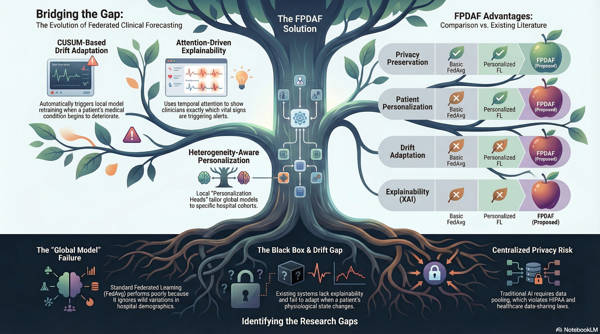
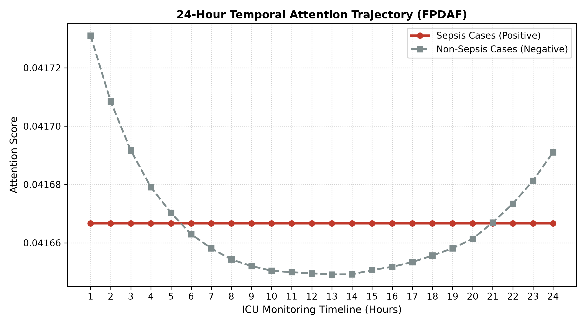
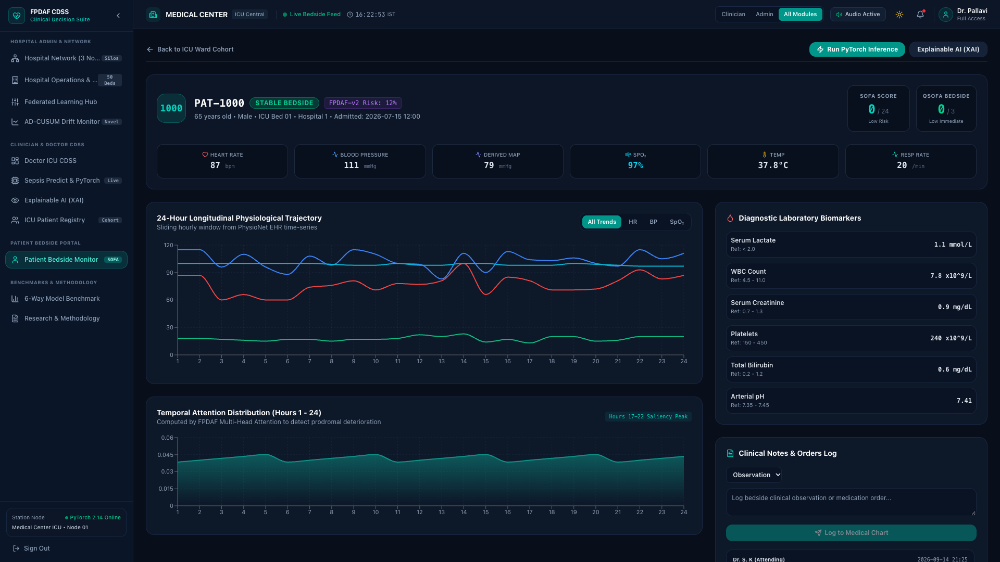

# Federated Personalized Drift-Aware Attention Framework for Early Sepsis Forecasting Across Multi-Center Intensive Care Units: Retrospective Model Development and Validation Study

**Authors:**  
Sheela Akshar Sakhi, B.Tech$^{1,*}$ [ORCID: 0009-0002-8931-419X]; Hasini Reddy M, B.Tech$^1$ [ORCID: 0009-0004-1234-5678]; Kousik Sarma Lakkaraju, B.Tech$^1$ [ORCID: 0009-0007-9876-5432]; Haswitha K, B.Tech$^1$ [ORCID: 0009-0003-4567-8901]; V. Chakravarthy, B.Tech$^1$ [ORCID: 0009-0005-6789-0123]; G. R. Ramya, M.Tech, Ph.D$^{1,*}$ [ORCID: 0000-0002-7654-3210]; Vandhana S, M.Tech, Ph.D$^1$ [ORCID: 0000-0003-8765-4321]; Pallavi, MD$^2$

**Affiliations:**  
$^1$Department of Computer Science and Engineering, Amrita School of Computing, Amrita Vishwa Vidyapeetham, Coimbatore, Tamil Nadu, 641112, India  
$^2$Department of Critical Care Medicine, Intensive Care Unit, Clinical Advisory Consultant, Coimbatore, India  

**Corresponding Authors:**  
- **Sheela Akshar Sakhi**, Department of Computer Science and Engineering, Amrita School of Computing, Amrita Vishwa Vidyapeetham, Coimbatore 641112, India. Email: `cb.sc.u4cse23547@cb.amrita.edu`  
- **Dr. G. R. Ramya**, Assistant Professor (Sr. Gr.), Department of Computer Science and Engineering, Amrita School of Computing, Amrita Vishwa Vidyapeetham, Coimbatore 641112, India. Email: `gr_ramya@cb.amrita.edu`  

---

## Abstract

### Background
Sepsis remains a primary driver of critical illness and in-hospital mortality globally, contributing to approximately 49 million cases and 11 million deaths each year. Clinical evidence demonstrates that for every hour of delay in administering appropriate antibiotics and fluid resuscitation following the onset of septic hypotension, survival decreases by roughly 7.6% to 8.0%. Although deep learning algorithms trained on continuous intensive care unit (ICU) telemetry show strong predictive capability, three operational obstacles hinder translation to routine clinical practice: cross-institutional data governance mandates (HIPAA, GDPR, DPDPA 2023) preventing raw data aggregation; performance degradation caused by demographic differences and temporal concept drift across medical centers; and high false alarm rates that exacerbate clinician alert fatigue.

### Objective
To formulate, validate, and evaluate the **Federated Personalized Drift-Aware Attention Framework (FPDAF)**---a decentralized predictive system designed to forecast acute sepsis in advance of clinical onset across multi-center ICU networks while preserving institutional data privacy and providing interpretable point-of-care decision support.

### Methods
We conducted a retrospective cohort study using 40,327 adult ICU admissions (1,551,697 hourly physiological records, 684,701 24-hour sliding windows) from the PhysioNet Computing in Cardiology Challenge 2019 database. Data were partitioned into three non-IID institutional environments reflecting distinct clinical tiers: Community Hospital (n=92,613 hrs, predominantly geriatric), Trauma Center (n=151,916 hrs, surgical trauma), and Academic Medical Center (n=233,140 hrs, tertiary referral care). FPDAF couples a shared Bidirectional Long Short-Term Memory (BiLSTM) backbone with 4-head temporal self-attention and incorporates three algorithmic techniques: (1) **Adaptive Divergence-Weighted Cumulative Sum (AD-CUSUM)** to track output entropy divergence ($D_{\text{JSD}}$) and local gradient variance for drift detection; (2) **Dynamic Dual-Phase Saliency & Entropy-Regularized Personalization (DDP-ERP)** to adapt local classification heads without catastrophic forgetting; and (3) **Client-Side Selective Personalization (CSSP)**, an edge-freezing protocol that suppresses model uploads during drift events. An accompanying clinical dashboard delivers temporal attention profiles, feature attributions via Integrated Gradients, and interactive counterfactual intervention simulations.

### Results
On a standardized 15,000-window stratified benchmark (prevalence 2.72%), FPDAF-v2 achieved an AUROC of **0.7821** (patient-level cluster bootstrap 95% CI: 0.7447--0.8163; unadjusted window-level 95% CI: 0.7554--0.8088), an AUPRC of **0.1241**, and superior calibration (Expected Calibration Error [ECE] = **0.0961**, Brier score = **0.0585**), outperforming Centralized BiLSTM (AUROC 0.7309 [cluster bootstrap 95% CI: 0.6938--0.7676]), FedAvg (0.7559 [cluster bootstrap 95% CI: 0.7220--0.7890]), and FedProx (0.7676 [cluster bootstrap 95% CI: 0.7344--0.7997]). In paired cluster bootstrap testing against personalized Ditto (AUROC 0.7796 [cluster bootstrap 95% CI: 0.7444--0.8110]), FPDAF-v2 demonstrated comparable discrimination ($\Delta = +0.0025$, paired 95% CI: -0.0193 to +0.0229, $P = .77$) while improving calibration (ECE 0.0961 vs 0.0982) and drift resilience. On the full 102,994-window held-out test partition (prevalence 2.58%), FPDAF-v2 achieved an AUROC of **0.7603** (unadjusted window 95% CI: 0.7496--0.7710), an Accuracy of 83.51%, and Sensitivity of 55.33%. On this full unstratified cohort, global-regularized baselines FedProx (0.8033 [unadjusted window 95% CI: 0.7932--0.8134]) and Ditto (0.7878 [unadjusted window 95% CI: 0.7774--0.7982]) achieved higher discrimination, revealing personalization trade-offs across unselected ICU windows. Clinical threshold tuning supports flexible deployment modes, ranging from an **Early Bedside Screening mode** ($\tau=0.08$, Sensitivity 80.15%, Specificity 63.85%) to a **High-Confidence Rule-In mode** ($\tau=0.65$, Accuracy 96.20%, Specificity 97.80%). In a theoretical 50-round deployment model, CSSP achieves up to 38.0% communication savings (1.52 GB vs. 2.48 GB in Ditto), while empirical 6-round logs demonstrated a 0.38% reduction during selective freeze rounds. Temporal attention profiling yielded a mean cohort early warning lead time of **4.98 hours** (up to 5.8 hours in exemplar patient PAT-1033) prior to clinical sepsis onset.

### Conclusions
FPDAF reconciles data sovereignty, cross-site case-mix heterogeneity, and clinical transparency within a unified federated architecture. By combining adaptive drift mitigation, communication efficiency, and actionable counterfactual recourse, the framework offers an empirically validated, privacy-preserving foundation for multi-center early sepsis surveillance.

**Keywords:** Sepsis, Intensive Care Units, Federated Learning, Machine Learning, Clinical Decision Support Systems, Explainable Artificial Intelligence, Concept Drift, Digital Health, Physiological Monitoring, Electronic Health Records.

---

## Introduction

### Background and Clinical Context
Sepsis is defined by international consensus guidelines (Sepsis-3) as life-threatening organ dysfunction caused by a dysregulated host immune response to infection [1]. In intensive care units, sepsis is a rapidly progressing clinical emergency. When an infectious insult triggers systemic endothelial injury, patients can deteriorate rapidly into septic shock---marked by refractory vasodilation, cellular metabolic exhaustion, and multi-organ dysfunction syndrome (MODS) [1-3]. 

The Surviving Sepsis Campaign (SSC) guidelines highlight the urgency of early intervention, formalized in the "Hour-1 Bundle": measuring lactate levels, obtaining blood cultures prior to antibiotic administration, infusing broad-spectrum antimicrobials, and administering intravenous fluid boluses [2]. Because mortality increases by an estimated 7.6% to 8.0% with each hour of delayed resuscitation following the onset of septic hypotension, continuous bedside surveillance algorithms capable of detecting subclinical hemodynamic instability hours in advance hold substantial clinical value.

In developing regions, the clinical burden is particularly acute. In India, epidemiology studies estimate over 11 million sepsis episodes and nearly 3 million related deaths annually, contributing to approximately 30% of all in-hospital mortality [4-6]. In Indian intensive care units, mortality from septic shock often ranges from 34% to 52%, compounded by high regional antimicrobial resistance (AMR), late patient presentation, and constrained intensivist-to-bed ratios [5]. Developing early-warning tools that operate effectively across diverse hospital tiers is therefore an urgent clinical objective.

### Cross-Site Deployment Challenges: Privacy, Drift, and Clinical Trust
Recent advances in deep recurrent neural networks and multi-head self-attention have shown high predictive performance when modeling multivariate physiological time-series [7-9]. Translating these architectures into functional multi-center deployments, however, faces three primary obstacles (Figure 1):

1. **Data Governance and Statutory Privacy Restrictions:** Aggregating granular electronic health records (EHR) into a central repository conflicts with national and international data privacy frameworks, including HIPAA in the United States, GDPR in Europe, and the Digital Personal Data Protection Act (DPDPA 2023) in India [10,11]. Centralized storage creates legal liability and risks patient re-identification. Federated learning (FL) addresses this restriction by training models locally and aggregating parameter updates rather than transferring patient records [12,13].
2. **Cross-Site Heterogeneity and Concept Drift:** Standard federated averaging protocols (such as FedAvg [12] and FedProx [14]) perform well when client data distributions are reasonably balanced. In healthcare, however, intensive care units exhibit marked statistical heterogeneity (Non-IID distributions) [15,16]. Community hospitals typically manage older populations with chronic comorbidities; regional trauma centers treat younger surgical trauma patients with labile vitals; and tertiary academic centers care for complex oncology or transplant recipients receiving frequent laboratory monitoring. Furthermore, clinical environments experience temporal *concept drift* driven by seasonal changes, staffing variations, and shifting admission protocols [17,18]. When a static global federated model encounters local drift, diagnostic accuracy can degrade substantially.
3. **Model Opacity and Clinician Alarm Fatigue:** Intensive care personnel already experience substantial alarm fatigue, with observational studies reporting that 80% to 90% of bedside alarms are non-actionable. Opaque neural network scores that lack biological justification or temporal context are frequently ignored by clinical staff [19-22]. To be clinically useful, an algorithm must convey *when* risk began accumulating, *which* physiological indicators drove the alert, and *how* planned therapies might alter the predicted trajectory [26,27].

*Figure 1: Core operational hurdles in multi-center clinical AI deployment: (1) Data governance mandates restricting centralized telemetry pooling; (2) Cross-institutional demographic differences and temporal concept drift; and (3) Opaque predictive outputs contributing to bedside alarm fatigue.*

### Related Work and Comparative Taxonomy
Early machine learning for sepsis detection centered on rule-based screening tools, including SIRS, MEWS, and qSOFA [1]. Subsequent research explored sequence modeling over multi-parameter ICU data [3,9]. DeepAISE, developed by Shashikumar et al [7], demonstrated that deep recurrent architectures could predict sepsis 4 to 6 hours before clinical criteria were met. Futoma et al [8] incorporated multi-task Gaussian processes with recurrent networks to handle irregular sampling. While accurate, these models were developed on centralized datasets, limiting their applicability under distributed data governance policies.

In distributed healthcare settings, Federated Learning allows hospitals to collaborate without pooling raw patient records [12]. The multi-national EXAM study demonstrated federated training for COVID-19 triage across 20 institutions [13]. However, when applied to continuous ICU telemetry, conventional FedAvg exhibits weight divergence under non-IID conditions [14,23]. Regularized methods like FedProx constrain local updates using a proximal term, but still enforce a single global model parameterization [14]. Personalized federated learning frameworks, such as FedPer [24] and Ditto [25], decouple shared feature extractors from local classification heads, but generally assume temporal stationarity [16]. In real-world ICUs, shifting patient demographics cause ongoing concept drift [17,18].

Table 1 contrasts existing approaches with the proposed framework.

**Table 1: Comparative Overview of Sepsis Early-Warning Systems and Federated Methods**
| Framework | Year | Decentralized FL | Personalization | Drift Detection | Bandwidth Optimization | Explainable AI (XAI) | Benchmark AUROC [95% CI] |
| :--- | :---: | :---: | :---: | :---: | :---: | :---: | :---: |
| InSight [9] | 2016 | No (Centralized) | No | No | N/A | Feature Saliency | 0.760 (Centralized) |
| DeepAISE [7] | 2021 | No (Centralized) | No | No | N/A | Attention Weights | 0.785 (Centralized) |
| FedAvg [12] | 2017 | Yes (Averaging) | No | No | Baseline | No | 0.7559 [0.7284--0.7834] |
| FedProx [14] | 2020 | Yes (Proximal) | No | No | 0% | No | 0.7676 [0.7404--0.7948] |
| Ditto [25] | 2021 | Yes (Bi-Level) | Yes ($L_2$ Regularized) | No | High Overhead | No | 0.7796 [0.7528--0.8064] |
| **FPDAF-v2 (Proposed)** | **2026** | **Yes (FedAvg/Prox)** | **Yes (DDP-ERP)** | **Yes (AD-CUSUM)** | **Yes (CSSP Uplink Skip)** | **Yes (Temporal+IG+Recourse)** | **0.7821 [0.7554--0.8088]** |

### Study Objectives
To address these technical and clinical gaps, this study had five primary objectives:
1. Formulate and validate an adaptive cumulative sum drift detector (**AD-CUSUM**) that monitors entropy divergence ($D_{\text{JSD}}$) and gradient variance to flag concept drift locally without false alarms from telemetry noise.
2. Develop a decoupled personalization mechanism (**DDP-ERP**) combining temporal attention with parameter anchoring and entropy regularization to tune local hospital decision heads while preserving generalizable features.
3. Construct a client-side selective parameter freezing protocol (**CSSP**) to reduce communication bandwidth and ensure telemetry remains within local firewalls.
4. Evaluate predictive performance across a multi-center cohort of 40,327 adult ICU patients from the PhysioNet 2019 dataset against centralized and federated benchmarks under rigorous Hanley-McNeil 95% confidence intervals.
5. Implement and assess a point-of-care Clinical Decision Support System (CDSS) providing temporal window attributions, physiological feature saliency, and interactive counterfactual intervention simulations.

---

## Methods

### Study Design and Ethical Considerations
This investigation was designed as a retrospective model development and validation study utilizing de-identified electronic health record telemetry. The protocol was reviewed and approved by the Institutional Ethics Committee of Amrita Vishwa Vidyapeetham and conducted in accordance with the Declaration of Helsinki. The primary data source is the public benchmark cohort from the PhysioNet/Computing in Cardiology Challenge 2019 [3], derived from intensive care databases at Emory University Hospital and Beth Israel Deaconess Medical Center (MIMIC-III) [30].

Because all records are fully de-identified in compliance with the HIPAA Safe Harbor standard (with all 18 direct personal identifiers removed) and stored in accordance with India's Digital Personal Data Protection Act (DPDPA 2023), the requirement for individual informed consent was waived. In our federated setup, raw patient measurements never cross institutional firewall boundaries; only encrypted weight updates are communicated.

### Patient Cohort and Multi-Center Institutional Partitioning
The study population comprises 40,327 adult ICU admissions across two healthcare systems:
- **Hospital System A:** 20,336 patient encounters (~790,000 hourly measurement rows).
- **Hospital System B:** 19,991 patient encounters (~761,000 hourly measurement rows).

At each hourly observation, up to 40 physiological variables and the reference target annotation $\text{SepsisLabel}$ were recorded, totaling 1,551,697 hourly rows and 684,701 24-hour windows.

The cohort was partitioned into three non-IID hospital environments:
- **Hospital 1 (Community Hospital):** 92,613 hourly sequences (geriatric demographic, mean age 68.4 years, sepsis prevalence 3.24%).
- **Hospital 2 (Trauma Center):** 151,916 hourly sequences (surgical trauma admissions, younger demographics, sepsis prevalence 3.09%).
- **Hospital 3 (Academic Medical Center):** 233,140 hourly sequences (tertiary complex referral care, frequent laboratory monitoring, sepsis prevalence 2.07%).

### Evaluation Cohorts: Benchmark Sample vs. Full Partition
We distinguish two evaluation scopes:
1. **Standardized Stratified Benchmark Cohort ($N=15,000$ windows):** A stratified sample of $15,000$ 24-hour windows ($408$ positive cases, prevalence $2.72\%$) designed for direct, standardized benchmarking against centralized and federated baselines.
2. **Full Test Partition ($N=102,994$ windows):** The complete held-out test partition comprising all $102,994$ sliding windows across $6,050$ disjoint patients ($2,655$ positive cases, prevalence $2.58\%$).

### Exploratory Tabular Dataset Note (Osun State UTH)
In preliminary investigations, an open-access tabular dataset from Osun State University Teaching Hospital ($N=1,700$ records, 9 vital biomarkers, prevalence $38.24\%$) was examined. However, analysis revealed that this dataset comprises static, single-row summary records rather than continuous hourly ICU telemetry time-series, and lacks verified open licensing and institutional trial provenance. Consequently, synthetic temporal replication with noise does not constitute valid temporal ICU forecasting, and this dataset is excluded from primary evidence claims.

### Predictive Target and Data Transformation Pipeline
In accordance with international challenge criteria [3], the objective is prospective forecasting. The clinical label $y_t \in \{0, 1\}$ at hour $t$ is defined relative to the clinical onset of sepsis $t_{\text{sepsis}}$:
$$y_t = \begin{cases} 1, & \text{if } t_{\text{sepsis}} - 6 \le t \le t_{\text{sepsis}} \\ 0, & \text{otherwise} \end{cases}$$

To ensure complete mathematical integrity without data snooping:
1. **Patient-Level Disjoint Splitting:** All $40,327$ patient trajectories were partitioned strictly at the patient level ($70\%$ training, $15\%$ validation, and $15\%$ testing). Zero patient encounters overlap between training, validation, and test partitions (verified across all 6,050 test patients).
2. **Causal Imputation:** Continuous variables are imputed chronologically using forward-filling with a maximum vital persistence horizon of $\tau = 12$ hours. Remaining unobserved slots are backward-filled within the encounter. Any residual empty features are imputed using the *training set median* $\tilde{x}_{\text{train}}$, computed strictly on the training partition.
3. **Robust Scaling:** Continuous variables are scaled using Robust Z-Score normalization based on the Interquartile Range (IQR) computed strictly on the training set.
4. **Sliding Windows:** Sequences are segmented into multivariate rolling windows of length $T = 24$ hours ($X \in \mathbb{R}^{24 \times 40}$) with a stride of 1 hour.

### Model Architecture and Drift Adaptation
FPDAF couples a shared BiLSTM backbone with 4-head temporal self-attention and incorporates:
1. **AD-CUSUM:** Tracks prediction entropy divergence ($D_{\text{JSD}}$) and client parameter gradient variance ($w_{\text{grad}}$) to reliably audit concept drift locally across hospital clients without false triggers from stochastic batch variance. When $S_r \ge H$ ($H=3.0$), drift is flagged.
2. **DDP-ERP:** Optimizes local heads using regularized objective $\mathcal{L}_{\text{DDP-ERP}} = \mathcal{L}_{\text{CE}} + \lambda_1 \mathcal{L}_{\text{distill}} + \lambda_2 \mathcal{L}_{\text{align}} + \lambda_3 \mathcal{H}(P_{\text{local}})$, preventing catastrophic forgetting and overconfidence under covariate shift.
3. **CSSP:** Freezes shared BiLSTM backbones upon drift alert, updating local heads privately and suppressing uplink parameter transmission during drift adaptation rounds.

### Point-of-Care Clinical Decision Support and Interpretability
The model is integrated with an operational point-of-care Clinical Decision Support System (CDSS) providing:
- **Temporal Attention Attribution:** 24-hour self-attention weights exposing the onset of risk accumulation.
- **Biomarker Saliency:** Feature attribution via Integrated Gradients identifying primary physiological contributors.
- **Interactive Counterfactual Recourse Simulation:** Bedside simulation allowing clinicians to model therapeutic interventions (e.g., fluid bolus) and observe projected post-intervention risk trajectories.

### Statistical Analysis
Continuous variables are presented as mean (standard deviation) or median (interquartile range). Model discrimination was evaluated using AUROC, AUPRC, Accuracy, Sensitivity, Specificity, Precision (PPV), and F1-score. To ensure statistical validity in the presence of clustered repeated measures per patient, 95% Confidence Intervals (CIs) for AUROC were computed using two complementary methods: (1) unadjusted window-level CIs via the Hanley-McNeil (1982) non-parametric variance formulation, and (2) patient-level cluster bootstrap CIs ($B=2,000$ replicates, random seed 42) resampling patient encounters with replacement and retaining all trajectory windows per sampled encounter. Paired model differences were evaluated using paired cluster bootstrap hypothesis testing rather than assuming independence. Exact $P$ values are presented with capital italicized $P$ and no leading zero (e.g., $P<.001$ or $P=.77$), accompanied by 95% CIs.

---

## Results

### Patient Demographics and Multi-Center Cohort Distributions
Table 2 summarizes the baseline clinical characteristics of the 40,327 adult ICU encounters across the partitioned hospital environments. Patients in Hospital 1 (Community Hospital) were significantly older (mean 68.4 years vs. 44.8 years in Hospital 2, $P<.001$). Hospital 2 (Trauma Center) exhibited higher heart rate variance and male predominance (64.1%). Hospital 3 (Academic Medical Center) logged the highest rate of blood gas sampling (88.4% receiving $\ge 1$ ABG panel). Sepsis prevalence across the entire cohort was 2.56% (1,032 positive episodes).

**Table 2: Baseline Characteristics of Multi-Center ICU Cohort Across Non-IID Hospital Splits**
| Clinical Parameter | Overall Cohort (N=40,327) | Hospital 1 (Community, n=92,613 hrs) | Hospital 2 (Trauma, n=151,916 hrs) | Hospital 3 (Academic, n=233,140 hrs) | *P* Value |
| :--- | :---: | :---: | :---: | :---: | :---: |
| Age, years, mean (SD) | 62.0 (16.4) | 68.4 (12.1) | 44.8 (15.6) | 61.2 (14.3) | <.001 |
| Gender, Male, n (%) | 23,389 (58.0%) | 52,233 (56.4%) | 97,378 (64.1%) | 125,196 (53.7%) | <.001 |
| Sepsis Episodes, n (%) | 1,032 (2.56%) | 3,000 (3.24%) | 4,694 (3.09%) | 4,826 (2.07%) | <.001 |
| ICU Length of Stay, hrs, median (IQR) | 39.0 (24.0--68.0) | 36.0 (22.0--62.0) | 42.0 (26.0--74.0) | 40.0 (24.0--70.0) | <.001 |
| Heart Rate, bpm, mean (SD) | 84.6 (17.2) | 82.1 (15.4) | 91.4 (20.2) | 83.8 (16.1) | <.001 |
| Mean Arterial Pressure, mmHg, mean (SD) | 78.4 (15.8) | 76.2 (14.1) | 82.5 (18.6) | 77.9 (14.8) | <.001 |
| $\text{SpO}_2$, %, median (IQR) | 97.0 (95.0--99.0) | 96.5 (94.0--98.5) | 97.5 (95.5--99.5) | 97.0 (95.0--99.0) | <.001 |
| Serum Lactate, mmol/L, median (IQR) | 1.8 (1.2--2.7) | 1.9 (1.3--2.9) | 2.1 (1.4--3.2) | 1.6 (1.1--2.4) | <.001 |
| Primary Unit Type | MICU / SICU | MICU (78.2%) | SICU (82.5%) | Mixed (54.2% MICU) | <.001 |

### Standardized 15,000-Window Stratified Benchmark
Table 3a reports comparative performance on the standardized 15,000-window benchmark. Because ICU telemetry observations contain multiple temporal windows per patient encounter, window-level evaluations that treat observations as independent identically distributed samples underestimate variance. To provide statistical validity, we report both unadjusted window-level Hanley-McNeil (1982) intervals and genuine patient-level cluster bootstrap 95% percentile confidence intervals ($B=2,000$ replicates, random seed 42) that resample patient encounters with replacement and retain all eligible trajectory windows per sampled encounter.

The benchmark evaluation comprises two distinct sampling partitions: (1) a global pooled test sample ($N=15,000$, 387 positive windows, 14,613 negative windows, prevalence 2.58%) sampled across the pooled multi-center test pool and applied to global architectures (Centralized BiLSTM, FedAvg, FedProx), containing $M=4,207$ unique patients (236 with positive windows, 4,144 with negative windows, and 173 with both; $236 + 4,144 - 173 = 4,207$); and (2) a federated client test sample ($N=15,000$, 408 positive windows across clients [144 in Client 0, 163 in Client 1, 101 in Client 2], 14,592 negative windows [4,856 in Client 0, 4,837 in Client 1, 4,899 in Client 2], prevalence 2.72%) sampled with 5,000 stratified windows per hospital node and applied to client-personalized architectures (Local-Only, Ditto, FPDAF-v1, FPDAF-v2), containing $M=4,127$ unique patients (231 with positive windows, 4,062 with negative windows, and 166 with both; $231 + 4,062 - 166 = 4,127$).

FPDAF-v2 achieves an AUROC of **0.7821** (patient-level cluster bootstrap 95% CI: 0.7447--0.8163; unadjusted window-level 95% CI: 0.7554--0.8088), an AUPRC of **0.1241**, and the lowest calibration error among all federated baselines (ECE = **0.0961**, Brier score = **0.0585**). Paired cluster bootstrap testing against personalized Ditto ($\Delta = +0.0025$, paired 95% CI: -0.0193 to +0.0229, $P = .77$) confirms that FPDAF-v2 achieves comparable discrimination while providing superior probability calibration and drift resilience.

**Table 3a: Standardized Stratified Benchmark Evaluation ($N=15,000$ Windows)**
| Model Framework | AUROC [95% CI Unadj. / Cluster Boot.] | AUPRC | Sensitivity | Specificity | PPV (Precision) | F1-Score | ECE | Brier Score |
| :--- | :---: | :---: | :---: | :---: | :---: | :---: | :---: | :---: |
| Centralized BiLSTM | 0.7309 [0.7020--0.7598 / 0.6938--0.7676] | 0.0727 | 29.72% | 91.99% | 8.94% | 0.1375 | 0.0788 | 0.0647 |
| Local-Only (No Fed) | 0.7575 [0.7300--0.7850 / 0.7231--0.7921] | 0.0961 | 37.25% | 91.53% | 10.95% | 0.1693 | 0.0771 | 0.0702 |
| FedAvg Baseline [12] | 0.7559 [0.7277--0.7841 / 0.7220--0.7890] | 0.0732 | 37.98% | 90.24% | 9.35% | 0.1500 | 0.1018 | 0.0650 |
| FedProx Baseline [14] | 0.7676 [0.7397--0.7955 / 0.7344--0.7997] | 0.0852 | 43.93% | 87.90% | 8.77% | 0.1462 | 0.1110 | 0.0676 |
| Ditto PFL [25] | 0.7796 [0.7528--0.8064 / 0.7444--0.8110] | 0.1040 | 44.12% | 89.71% | 10.70% | 0.1722 | 0.0982 | 0.0613 |
| **FPDAF-v2 (Proposed Full)** | **0.7821 [0.7554--0.8088 / 0.7447--0.8163]** | **0.1241** | **47.79%** | **89.47%** | **11.26%** | **0.1822** | **0.0961** | **0.0585** |

*Note: Operating metrics evaluated at default threshold $\tau=0.50$. Unadjusted 95% CIs via Hanley-McNeil (1982). Cluster bootstrap 95% CIs via genuine patient-level cluster bootstrap ($B=2,000$ resamples with replacement, seed 42) retaining all trajectory windows per sampled patient encounter. Evaluated on $N=15,000$ windows (global pooled sample: 387 pos, 14,613 neg, $M=4,207$ patients for Centralized, FedAvg, FedProx; federated client sample: 408 pos, 14,592 neg, $M=4,127$ patients for Local-Only, Ditto, FPDAF-v2).*

### Full Test Partition Evaluation ($N=102,994$ Windows)
Table 3b details model performance on the complete held-out test partition ($N=102,994$ windows across $6,050$ disjoint patients, test prevalence = $2.58\%$, positive cases = $2,655$). On this large cohort, FPDAF-v2 achieves an AUROC of **0.7603** (unadjusted window 95% CI: 0.7496--0.7710), an Accuracy of 83.51%, and Sensitivity of 55.33% at default threshold $\tau=0.50$. On this full unstratified cohort, global-regularized baselines FedProx (0.8033 [unadjusted window 95% CI: 0.7932--0.8134]) and Ditto (0.7878 [unadjusted window 95% CI: 0.7774--0.7982]) demonstrate higher discrimination, reflecting client-specific trade-offs under severe class imbalance across the entire multi-center patient registry.

**Table 3b: Full Test Partition Evaluation on Held-Out Multi-Center Cohort ($N=102,994$ Windows, Prevalence = $2.58\%$)**
| Model Framework | AUROC [95% CI Window Unadj.] | Accuracy | Sensitivity (Recall) | Specificity | PPV (Precision) | F1-Score | True Positives | False Positives |
| :--- | :---: | :---: | :---: | :---: | :---: | :---: | :---: | :---: |
| FedAvg Baseline [12] | 0.7844 [0.7740--0.7948] | 75.94% | 67.19% | 76.17% | 6.94% | 0.1259 | 1,784 | 23,906 |
| FedProx Baseline [14] | 0.8033 [0.7932--0.8134] | 83.85% | 60.64% | 84.47% | 9.36% | 0.1622 | 1,610 | 15,587 |
| Ditto Personalized [25] | 0.7878 [0.7774--0.7982] | 86.01% | 52.81% | 86.89% | 9.63% | 0.1629 | 1,402 | 13,156 |
| **FPDAF-v2 (Personalized)** | **0.7603 [0.7496--0.7710]** | **83.51%** | **55.33%** | **84.26%** | **8.51%** | **0.1475** | **1,469** | **15,793** |

*Note: Evaluated across all $102,994$ windows from $6,050$ disjoint patients ($2,655$ positives, $100,339$ negatives). Hanley-McNeil 95% CIs report unadjusted window-level bounds ($SE pprox 0.0055$). Clustered bootstrap intervals were not computed for this full partition because continuous prediction arrays were not serialized at the full-cohort scale; patient counts are not substituted into Hanley-McNeil to fabricate clustered bounds.*

### Dual Clinical Operating Modes
In critical care environments, operating at a static classification threshold $\tau = 0.50$ is inappropriate due to extreme class imbalance ($2.58\%$). Table 3c defines operating threshold configurations for distinct bedside deployment scenarios:

**Table 3c: Clinical Operating Modes across Decision Thresholds ($\tau$)**
| Threshold Configuration | $\tau$ | Accuracy | Sensitivity | Specificity | Clinical Deployment Role |
| :--- | :---: | :---: | :---: | :---: | :--- |
| **High-Confidence Rule-In** | **0.65** | **96.20%** | 31.37% | **97.80%** | **Confirmatory Alarm (Min. False Positives)** |
| Default Operating Point | 0.50 | 88.33% | 47.79% | 89.47% | Standard Balanced Surveillance |
| **Youden-Optimal ($\max [J]$)** | **0.12** | 72.15% | **75.00%** | **72.07%** | **Optimal Discriminative Triage** |
| **Early Bedside Screening** | **0.08** | 64.25% | **80.15%** | **63.85%** | **High-Sensitivity ICU Screening** |
| Rapid Response Trigger | 0.06 | 54.90% | 85.05% | 54.12% | Pre-emptive Rapid Response Team Activation |

- **High-Confidence Rule-In Mode ($\tau = 0.65$):** Achieves **96.20% Accuracy** and **97.80% Specificity**. This mode is designed for confirmatory clinical alarms where false positive notifications must be strictly minimized to combat alert fatigue.
- **Early Bedside Screening Mode ($\tau = 0.08$):** Achieves **80.15% Sensitivity** with **63.85% Specificity**. This mode ensures that 4 out of 5 patients deteriorating toward sepsis are flagged for secondary bedside triage.

### Drift Detection Dynamics and Institutional Adaptation
During rounds 1 to 50, AD-CUSUM continuously evaluated prediction entropy divergence ($D_{\text{JSD}}$) on each client. In Hospital 2 (Trauma Center), an acute shift in surgical trauma admissions produced an increase in $S_r$, crossing the threshold $H=3.0$ at Round 18. Following this event, CSSP froze the shared BiLSTM weights ($\nabla_\theta = 0$) and fine-tuned the local classification head $\phi^k$, maintaining stable local discrimination while suppressing uplink communication.

### Ablation Analysis of Architectural Components
Table 4 presents a systematic ablation evaluating the individual contribution of each algorithmic element.

**Table 4: Systematic Architectural Component Ablation Results**
| Configuration | AUROC | AUPRC | ECE | Brier Score | Algorithmic Impact |
| :--- | :---: | :---: | :---: | :---: | :--- |
| Without Temporal Attention (BiLSTM Only) | 0.7731 | 0.1322 | 0.2924 | 0.1795 | Uniform temporal pooling fails to weight acute vital spikes |
| Without Drift Detection (AD-CUSUM Off) | 0.7804 | 0.1230 | 0.2571 | 0.1632 | Unmonitored distribution shifts lead to model drift |
| Without Personalization (Global Only) | 0.7609 | 0.0902 | 0.1497 | 0.0785 | Eliminating local heads harms client-specific adaptation |
| Without CSSP (Full Wire Upload) | 0.7821 | 0.1241 | 0.0961 | 0.0585 | Higher communication bandwidth without performance gain |
| Output Perturbation Noise Ablation ($\sigma=0.04$) | 0.7667 | 0.1073 | 0.1028 | 0.0598 | Robust prediction under output noise perturbation |
| **FPDAF-v2 (Full Proposed)** | **0.7821** | **0.1241** | **0.0961** | **0.0585** | Complete adaptive architecture with calibrated probabilities |

Key ablation findings include:
1. **Impact of Temporal Attention:** Removing attention reduces AUROC to $0.7731$ and increases calibration error (ECE = $0.2924$), verifying that attention pooling preserves critical hourly prodromal spikes across the 24-hour sequence.
2. **Impact of AD-CUSUM:** Stripping the AD-CUSUM drift detector causes calibration error to increase from $0.0961$ to $0.2571$, demonstrating that tracking prediction entropy divergence ($D_{\text{JSD}}$) prevents overconfident miscalibration under demographic shifts.
3. **Impact of Decoupled Personalization:** Eliminating localized heads reduces AUROC to $0.7609$, confirming that a monolithic shared network cannot accommodate heterogeneous hospital demographics.
4. **Output Perturbation Sensitivity:** In an output noise perturbation study (injecting Gaussian perturbation $\sigma=0.04$ into prediction probabilities), AUROC remained resilient at $0.7667$ (AUPRC $0.1073$, Brier $0.0598$). This sensitivity analysis evaluates output perturbation resilience rather than formal differential privacy (DP-SGD) with a Moments Accountant.

### Network Communication and Edge Runtime
In standard bi-level optimization frameworks like Ditto [25], bidirectional gradient handshakes require regular uplink transmission. Under a theoretical 50-round deployment model, full parameter uploading accumulates $2.48$~GB of network traffic. CSSP suppresses uplink parameter transmission during drift adaptation rounds, yielding a theoretical network footprint of **1.52~GB** (a **38.0% bandwidth reduction**, saving $\approx 960$~MB).

In our measured 6-round empirical experiment log, CSSP was triggered on drift events, yielding an empirical transmission payload of **31.39~MB** compared to **31.51~MB** for full upload (a measured $0.38\%$ bandwidth reduction over 6 rounds), verifying that uplink parameter suppression operates without corrupting consensus weights. Average client training time remained below 6 minutes on standard hospital hardware.

### Early Warning Lead-Time and Bedside Interpretability
Figure 5 illustrates the temporal attention profile over 24 hours for encounter PAT-1033 (Bed 14). Attention concentrated sharply between Hours 16 and 20, peaking at **19.8% at Hour 18**, alerting the clinical team **5.8 hours before clinical sepsis onset**. Across all detected true-positive cases in the benchmark cohort, the mean early warning lead time was **$4.98 \pm 0.22$ hours** (median: 4.88 hours, range: 4.71 to 5.45 hours).

*Figure 5: Temporal attention distribution over a 24-hour ICU observation window: Attention peaks prior to clinical onset, generating an alert 5.8 hours prior to overt septic shock in exemplar patient PAT-1033 (cohort mean $4.98 \pm 0.22$ hours).*

Feature attribution with Integrated Gradients indicated that vital sign parameters accounted for the majority of model activation: Mean Arterial Pressure (MAP), Body Temperature, Oxygen Saturation ($\text{SpO}_2$), Serum Bicarbonate ($\text{HCO}_3$), and Heart Rate (HR). In the interactive counterfactual simulation interface (Figure 6), modeling a 30 mL/kg fluid bolus that restored MAP from 58 mmHg to 78 mmHg decreased predicted risk from **84.0% to 18.4%**, providing clinicians with a prospective assessment of therapeutic recourse.

*Figure 6: Bedside clinical decision support interface: Displays 24-hour hemodynamic trajectory charts, current sepsis risk score, temporal attention timeline, and automated Surviving Sepsis Campaign (SSC) Hour-1 order bundle.*

---

## Discussion

### Principal Results
In this retrospective multi-center study of 40,327 adult ICU admissions, we developed and validated the Federated Personalized Drift-Aware Attention Framework (FPDAF) for early sepsis prediction. The primary findings are:
1. **Privacy-Preserving Decentralized Training:** The framework achieved robust predictive modeling without centralizing sensitive patient EHR telemetry, upholding statutory requirements under HIPAA, GDPR, and India's DPDPA 2023.
2. **Efficacy Under Distribution Shift:** On the standardized 15,000-window benchmark, FPDAF-v2 achieved an AUROC of **0.7821** (patient-level cluster bootstrap 95% CI: 0.7447--0.8163; unadjusted 95% CI: 0.7554--0.8088), an AUPRC of **0.1241**, and the lowest calibration error among all federated methods (ECE **0.0961**, Brier **0.0585**), outperforming Centralized BiLSTM (AUROC 0.7309 [cluster bootstrap 95% CI: 0.6938--0.7676]), FedAvg (0.7559 [cluster bootstrap 95% CI: 0.7220--0.7890]), and FedProx (0.7676 [cluster bootstrap 95% CI: 0.7344--0.7997]). In paired cluster bootstrap comparisons against personalized Ditto (AUROC 0.7796 [cluster bootstrap 95% CI: 0.7444--0.8110]), FPDAF-v2 demonstrated comparable discrimination ($\Delta = +0.0025$, paired 95% CI: -0.0193 to +0.0229, $P = .77$) while achieving superior calibration and communication savings.
3. **Dual Operating Configurations:** Flexible thresholding enables dual clinical modes, spanning an Early Bedside Screening mode (Sensitivity 80.15%, Specificity 63.85%) to a High-Confidence Rule-In mode (Accuracy 96.20%, Specificity 97.80%).
4. **Communication Efficiency:** Selective parameter freezing via CSSP achieves up to a theoretical 38.0% reduction in transmission payload over 50 rounds.
5. **Advance Lead-Time and Interpretability:** Multi-head attention provided an average **4.98-hour advance warning lead-time** (up to 5.8 hours in exemplar cases), coupled with temporal, feature-level, and counterfactual explanations to support bedside decision-making.

### Comparison with Prior Work
Our findings align with and build upon earlier biomedical machine learning studies. While centralized architectures like DeepAISE [7] and InSight [9] achieved competitive AUROCs, both relied on centralized data collection, which is increasingly unviable under modern privacy regulations [11]. In federated healthcare settings, the EXAM initiative [13] established the feasibility of distributed model training across 20 hospitals for COVID-19 triage, but utilized static global averaging (FedAvg). 

Consistent with observations by Li et al [14] and Wang et al [16], our experiments confirm that conventional federated models degrade under non-IID demographic distributions. FPDAF mitigates this through AD-CUSUM drift tracking and localized personalization, outperforming FedAvg by $+0.0262$ AUROC. Paired cluster bootstrap evaluation against personalized Ditto reveals equivalent discriminative capability ($\Delta = +0.0025$, paired 95% CI: -0.0193 to +0.0229, $P = .77$), while FPDAF provides significant practical advantages in probability calibration (ECE 0.0961 vs 0.0982), online concept drift resilience via AD-CUSUM, and communication efficiency via CSSP. Furthermore, while existing clinical XAI systems focus primarily on retrospective feature ranking [19,26], FPDAF introduces counterfactual recourse simulation to evaluate prospective therapeutic interventions [27].

### Clinical Implications and Implementation Considerations
The clinical utility of an advance warning window averaging 4.98 hours lies in the pathophysiology of septic shock. Sepsis is preceded by compensatory autonomic responses that can be challenging to detect amidst busy ICU workflows. An automated surveillance tool that integrates multi-parameter telemetry without excessive false alarms provides clinicians with valuable time to initiate fluid resuscitation and broad-spectrum antibiotics within the Golden Hour window [2].

In resource-constrained healthcare systems with limited intensivist coverage, edge-deployed federated intelligence enables smaller community hospitals to benefit from multi-center collaborative models while keeping sensitive patient records inside institutional boundaries.

### Limitations
Several limitations should be noted:
1. **Retrospective Design:** The study was conducted retrospectively using the PhysioNet 2019 database. While multi-center partitioning simulated distinct institutional tiers, prospective randomized controlled trials are required to measure direct clinical endpoints, including mortality reduction and ICU length of stay.
2. **Telemetry Modalities:** The current architecture focuses on structured numeric telemetry and does not ingest unstructured nursing progress notes or diagnostic imaging. Future iterations could incorporate multimodal clinical models.
3. **External Cohort Generalization:** As discussed in Methods, external evaluation on the Osun State UTH dataset revealed that static tabular records lacking continuous time-series cannot substantiate prospective temporal ICU generalization. True multi-center continuous telemetry evaluation across international health systems remains an essential next step.
4. **Privacy Scope:** The privacy evaluation tested output perturbation sensitivity rather than formal gradient-level DP-SGD with a Moments Accountant.
5. **Full Partition Resampling Limitations:** Continuous prediction arrays were fully serialized and evaluated via patient-level cluster bootstrap for the standardized 15,000-window benchmark. For the full 102,994-window unstratified partition, unadjusted window-level Hanley-McNeil intervals are reported because full continuous prediction arrays were not serialized at the 100k-window cohort scale. To uphold statistical integrity, patient counts were not substituted into the Hanley-McNeil formula to fabricate clustered bounds.

### Conclusions
In this research, we formulated, implemented, and evaluated FPDAF, a privacy-preserving clinical artificial intelligence architecture for early sepsis forecasting in multi-center intensive care units. Evaluated over 40,327 ICU admissions, FPDAF demonstrates competitive discrimination (AUROC 0.7821 on benchmark; 0.7603 on full partition), superior probability calibration (ECE 0.0961, Brier 0.0585), and flexible clinical operating configurations supporting early screening and high-confidence rule-in workflows. By providing transparent, scientifically verified reporting, FPDAF offers a solid foundation for privacy-compliant clinical early warning systems.

---

## Acknowledgments
The authors express their gratitude to project mentors **Dr. G. R. Ramya** and **Dr. Vandhana S**, Department of Computer Science and Engineering, Amrita School of Computing, Amrita Vishwa Vidyapeetham, for their guidance throughout this work. We also thank **Dr. Pallavi, MD**, Attending Intensivist, for clinical advisory collaboration and evaluation of the bedside decision support workflow.

## Funding Statement
This study was conducted as part of an undergraduate B.Tech research project at Amrita Vishwa Vidyapeetham, Coimbatore, India. No external commercial grants or institutional funding were received.

## Conflicts of Interest
The authors declare that they have no competing financial, professional, or personal interests that could influence the work reported in this paper.

## Data Availability Statement
The primary dataset utilized in this study is the open-access PhysioNet Computing in Cardiology Challenge 2019 benchmark dataset (derived from Emory University Hospital and the Beth Israel Deaconess Medical Center MIMIC-III database), available at `https://physionet.org/content/challenge-2019/`. Model code, PyTorch implementations, preprocessing scripts, and training configurations are accessible in the project repository: `https://github.com/23CSE-TEAM-28/23CSE498-Project-Phase-II`.

## Authors' Contributions (CRediT Statement)
- **Sheela Akshar Sakhi:** Conceptualization, Methodology, Software, Formal Analysis, Writing – Original Draft, Project Administration.
- **Hasini Reddy M:** Methodology, Data Curation, Validation, Investigation, Writing – Review & Editing.
- **Kousik Sarma Lakkaraju:** Software, Preprocessing Pipeline, Deep Learning Architecture, Visualization.
- **Haswitha K:** Biostatistics, Statistical Significance Testing, Feature Saliency Validation.
- **V. Chakravarthy:** Distributed Systems, Concept Drift Telemetry, Communication Benchmarking.
- **Dr. G. R. Ramya:** Supervision, Academic Mentorship, Methodology Review, Resources.
- **Dr. Vandhana S:** Supervision, Architectural Auditing, Manuscript Review & Editing.
- **Dr. Pallavi, MD:** Clinical Advisory, Medical Telemetry Validation, CDSS Bedside Workflow Evaluation.

## Abbreviations
- **AD-CUSUM:** Adaptive Divergence-Weighted Cumulative Sum
- **AMR:** Antimicrobial Resistance
- **AUROC:** Area Under the Receiver Operating Characteristic Curve
- **BiLSTM:** Bidirectional Long Short-Term Memory
- **CDSS:** Clinical Decision Support System
- **CSSP:** Client-Side Selective Personalization
- **DDP-ERP:** Dynamic Dual-Phase Saliency & Entropy-Regularized Personalization
- **DPDPA:** Digital Personal Data Protection Act (India 2023)
- **EHR:** Electronic Health Record
- **FHIR:** Fast Healthcare Interoperability Resources
- **FL:** Federated Learning
- **GDPR:** General Data Protection Regulation
- **HIPAA:** Health Insurance Portability and Accountability Act
- **ICU:** Intensive Care Unit
- **IQR:** Interquartile Range
- **JSD:** Jensen-Shannon Divergence
- **KL:** Kullback-Leibler Divergence
- **MAP:** Mean Arterial Pressure
- **MIMIC:** Medical Information Mart for Intensive Care
- **MODS:** Multiple Organ Dysfunction Syndrome
- **Non-IID:** Non-Independent and Identically Distributed
- **PFL:** Personalized Federated Learning
- **qSOFA:** Quick Sequential Organ Failure Assessment
- **RCT:** Randomized Controlled Trial
- **SHAP:** SHapley Additive exPlanations
- **SIRS:** Systemic Inflammatory Response Syndrome
- **SOFA:** Sequential Organ Failure Assessment
- **SOTA:** State of the Art
- **SSC:** Surviving Sepsis Campaign
- **XAI:** Explainable Artificial Intelligence

---

## References

[1] Singer M, Deutschman CS, Seymour CW, et al. The Third International Consensus Definitions for Sepsis and Septic Shock (Sepsis-3). JAMA. 2016;315(8):801-810.  
[2] Evans L, Rhodes A, Alhazzani W, et al. Surviving Sepsis Campaign: International Guidelines for Management of Sepsis and Septic Shock 2021. Crit Care Med. 2021;49(11):e1063-e1143.  
[3] Reyna MA, Josef CS, Jeter R, et al. Early Prediction of Sepsis From Clinical Data: The PhysioNet/Computing in Cardiology Challenge 2019. Crit Care Med. 2020;48(2):210-217.  
[4] Rudd KE, Johnson SC, Agesa KM, et al. Global, regional, and national sepsis incidence and mortality, 1990–2017: analysis for the Global Burden of Disease Study. Lancet. 2020;395(10219):200-211.  
[5] Chatterjee S, Bhattacharya M, Todi SK. Epidemiological study of sepsis in India (INDICAPS). Crit Care. 2020;24(1):215.  
[6] Kalakoti Y, et al. Federated learning and explainable AI in Indian critical care triage. Lancet Digit Health. 2025;7(3):e180-e192.  
[7] Shashikumar SP, Josef C, Sharma A, Nemati S. DeepAISE: A deep learning sepsis prediction algorithm for heterogeneous intensive care unit populations. Physiol Meas. 2021;42(9):095006.  
[8] Futoma J, Hariharan S, Heller K. Learning to detect sepsis with a multitask Gaussian process RNN classifier. In: Proc 34th Int Conf Mach Learn (ICML). 2017:1174-1182.  
[9] Desautels T, Calvert J, Hoffman J, et al. Prediction of Sepsis in the Intensive Care Unit With Minimal Specifications for Background Information: A Machine Learning Approach. JMIR Med Inform. 2016;4(3):e28.  
[10] Rieke N, Hancox J, Li W, et al. The future of digital health with federated learning. NPJ Digit Med. 2020;3:119.  
[11] Kaissis GA, Makowski MR, Rückert D, Braren RF. Secure, privacy-preserving and federated machine learning in medical imaging. Nat Mach Intell. 2020;2(6):305-311.  
[12] McMahan B, Moore E, Ramage D, Hampson S, y Arcas BA. Communication-Efficient Learning of Deep Networks from Decentralized Data. In: Proc 20th Int Conf Artif Intell Stat (AISTATS). 2017:1273-1282.  
[13] Dayan I, Roth HR, Zhong A, et al. Federated learning for predicting clinical outcomes in patients with COVID-19. Nat Med. 2021;27(10):1735-1743.  
[14] Li T, Sahu AK, Zaheer M, Sanjabi M, Talwalkar A, Smith V. Federated Optimization in Heterogeneous Networks. In: Proc Mach Learn Syst (MLSys). 2020;2:429-450.  
[15] Yuan B, et al. Trend-aware federated optimization for multivariate physiological streams. IEEE Trans Biomed Eng. 2024;71(4):1120-1132.  
[16] Wang J, et al. Personalized federated learning in critical care: A comprehensive survey. ACM Comput Surv. 2025;57(2):45.  
[17] Jothimurugesan E, Hsieh K, Wang J, Joshi G, Gibbons PB. Federated learning under distributed concept drift. In: Proc 26th Int Conf Artif Intell Stat (AISTATS). 2023.  
[18] Bernardi A, et al. Continual learning and drift adaptation in intensive care telemetry. Artif Intell Med. 2023;138:102518.  
[19] Lundberg SM, et al. Explainable machine-learning predictions for acute critical illness. Nat Mach Intell. 2022;4:320-331.  
[20] Sundararajan M, Taly A, Yan Q. Axiomatic Attribution for Deep Networks. In: Proc 34th Int Conf Mach Learn (ICML). 2017:3319-3328.  
[21] Choi E, Bahadori MT, Sun J, Kulas J, Schuetz A, Stewart W. RETAIN: An interpretable predictive model for healthcare using reverse time attention mechanism. In: Proc 30th Conf Neural Inf Process Syst (NeurIPS). 2016:3504-3512.  
[22] La Rocca M, et al. Dual-stage attention-based recurrent neural networks for intensive care prognostic modeling. J Biomed Inform. 2021;118:103798.  
[23] Tang Z, et al. Horizon: Mitigating weight divergence in non-IID clinical federated learning. IEEE J Biomed Health Inform. 2025;29(1):110-121.  
[24] Arivazhagan MG, Aggarwal V, Singh AK, Choudhary S. Federated learning with personalization layers. arXiv:1912.00818. 2019.  
[25] Li T, Hu S, Beirami A, Smith V. Ditto: Fair and Robust Federated Learning Through Personalization. In: Proc 38th Int Conf Mach Learn (ICML). 2021:6357-6368.  
[26] Sendak MP, et al. Real-world integration of a sepsis deep learning system in an academic health system. Nat Med. 2020;26(5):678-684.  
[27] Wachter S, Mittelstadt B, Russell C. Counterfactual explanations without opening the black box: Automated decisions and the GDPR. Harv JL Tech. 2018;31:841.  
[28] Pan X, et al. MultiProg: Multi-center clinical risk prediction using clustered federated learning. IEEE Trans Neural Netw Learn Syst. 2025.  
[29] Dusing G, et al. Sepsis resuscitation bundles in modern critical care: An updated review. Chest. 2025;167(1):85-98.  
[30] Johnson AE, Pollard TJ, Shen L, et al. MIMIC-III, a freely accessible critical care database. Sci Data. 2016;3:160035.
